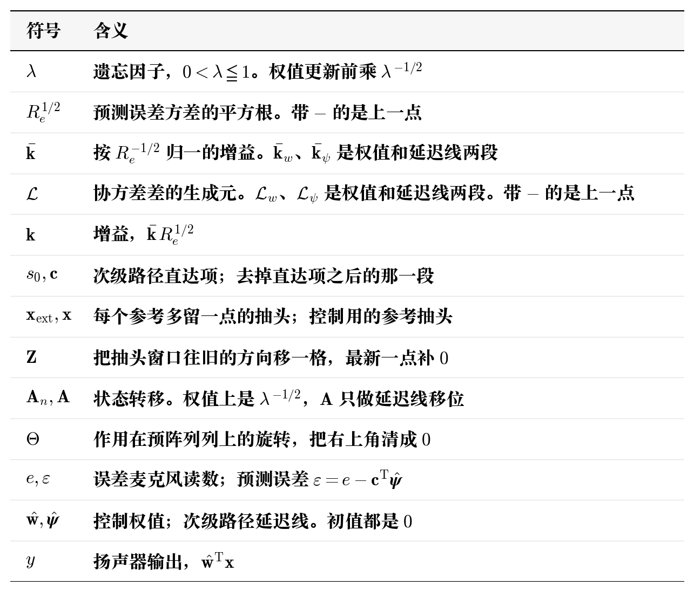
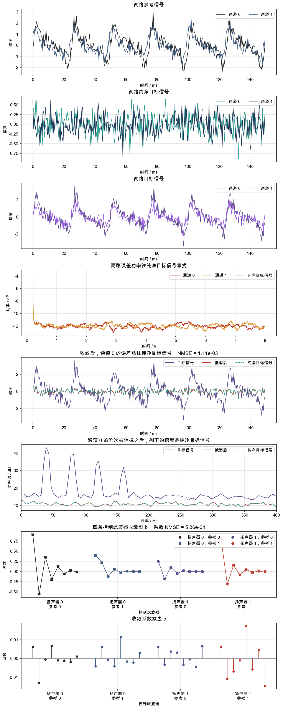
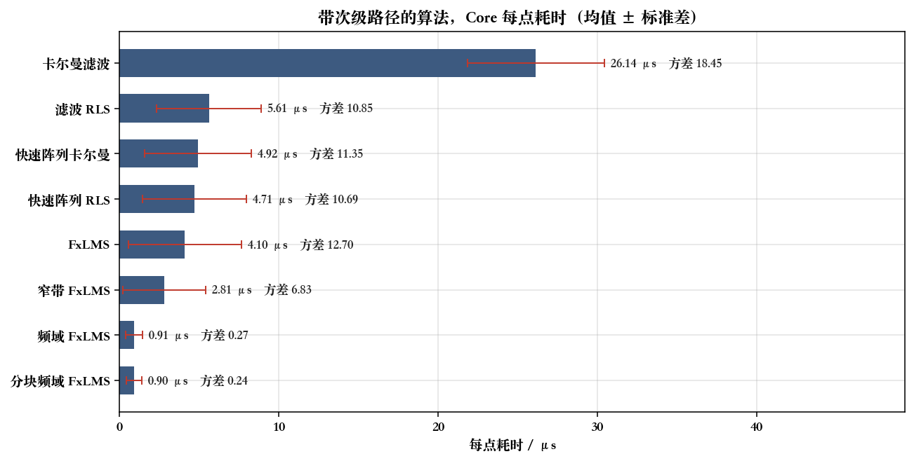
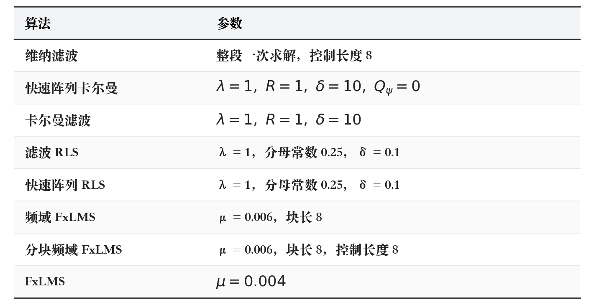
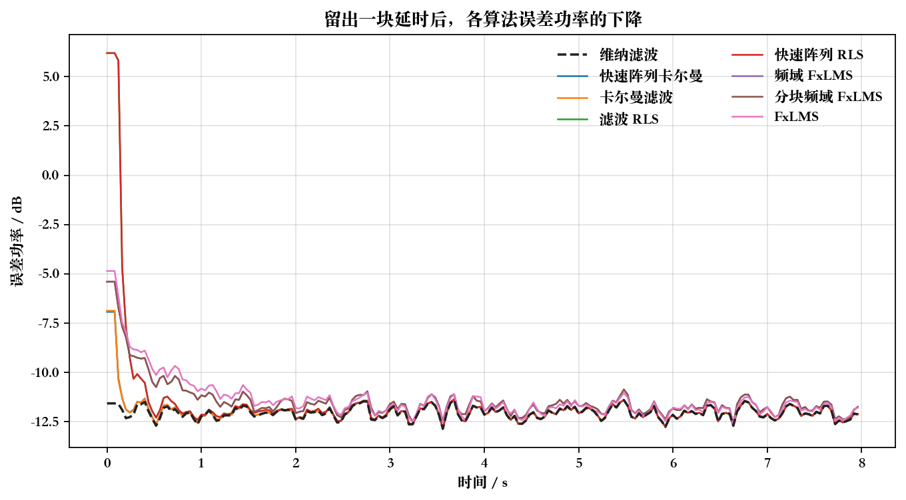
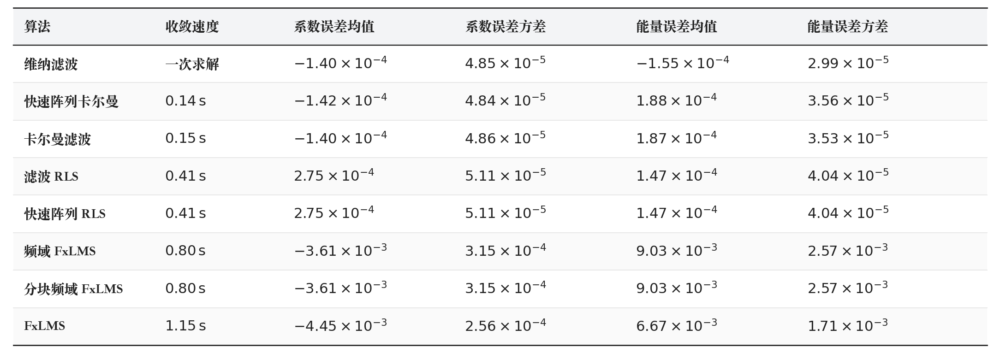
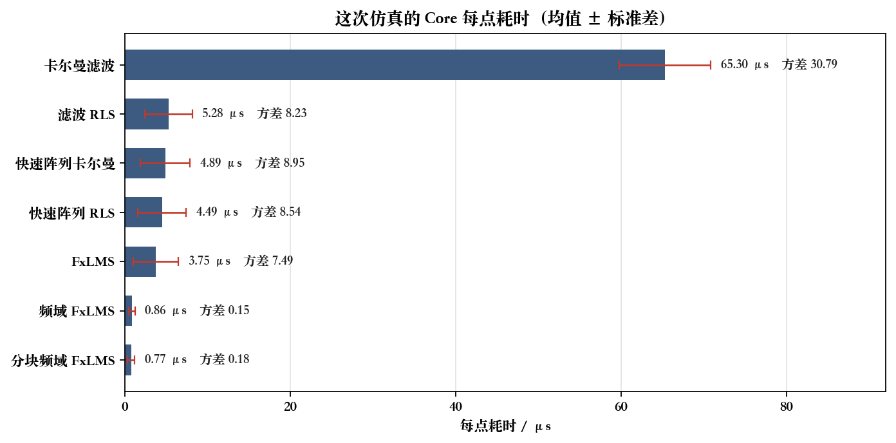
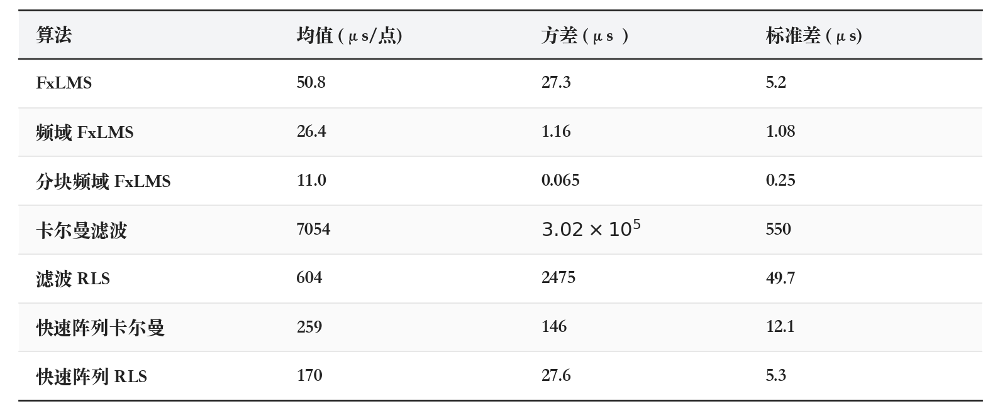

# 快速阵列卡尔曼

上一章也说过，卡尔曼和 RLS 有许多相似之处，包括算力消耗依旧很大以及可以引入 fast-array 进行优化。文献仍然是 R. Fraanje、A. H. Sayed、M. Verhaegen、N. J. Doelman，*A fast-array Kalman filter solution to active noise control*，*International Journal of Adaptive Control and Signal Processing*，2005，19（2–3）：125–152。

ps:公式推导只是按照自己的理解进行简化版的推导，也许并不严谨。

## 1. 数学模型

**符号**

基础原理与 RLS 算法的 fast-array 版本完全一致，此处不做重复推导，直接给出推导式

$$
\begin{aligned}
\begin{bmatrix}
R_e^{1/2}&\mathbf{0}\\
\bar{\mathbf{k}}&\mathcal{L}
\end{bmatrix}
&\leftarrow
\begin{bmatrix}
R_{e,-}^{1/2}&
s_0\mathbf{x}_{\mathrm{ext}}^{\mathsf T}\mathcal{L}_{w,-}
+\mathbf{c}^{\mathsf T}\mathcal{L}_{\psi,-}\\
\begin{bmatrix}
\mathbf{Z}\bar{\mathbf{k}}_{w,-}\\
\bar{\mathbf{k}}_{\psi,-}
\end{bmatrix}
&
\mathbf{A}_n\mathcal{L}_{-}
\end{bmatrix}
\Theta\\
\mathbf{k}
&=\bar{\mathbf{k}}\,R_e^{1/2}
\end{aligned}
$$

由此得到迭代更新公式

$$
\begin{aligned}
\varepsilon
&=e-\mathbf{c}^{\mathsf T}\hat{\boldsymbol{\psi}}\\
\begin{bmatrix}
R_e^{1/2}&\mathbf{0}\\
\bar{\mathbf{k}}&\mathcal{L}
\end{bmatrix}
&\leftarrow
\begin{bmatrix}
R_{e,-}^{1/2}&
s_0\mathbf{x}_{\mathrm{ext}}^{\mathsf T}\mathcal{L}_{w,-}
+\mathbf{c}^{\mathsf T}\mathcal{L}_{\psi,-}\\
\begin{bmatrix}
\mathbf{Z}\bar{\mathbf{k}}_{w,-}\\
\bar{\mathbf{k}}_{\psi,-}
\end{bmatrix}
&
\mathbf{A}_n\mathcal{L}_{-}
\end{bmatrix}
\Theta\\
\hat{\mathbf{w}}
&\leftarrow\lambda^{-1/2}\hat{\mathbf{w}}
+\bar{\mathbf{k}}_w\,\varepsilon/R_e^{1/2}\\
\hat{\boldsymbol{\psi}}
&\leftarrow\mathbf{A}\hat{\boldsymbol{\psi}}
+\bar{\mathbf{k}}_{\psi}\,\varepsilon/R_e^{1/2}\\
y
&=\hat{\mathbf{w}}^{\mathsf T}\mathbf{x}
\end{aligned}
$$

初值为 $\hat{\mathbf{w}}=\mathbf{0}$，$\hat{\boldsymbol{\psi}}=\mathbf{0}$，$\bar{\mathbf{k}}_w=\mathbf{0}$。

## 2. 实例

取 $P=2$，$L=2$，$Q=2$，$M=1$，$M_s=2$，$\lambda=1$，$R=1$，$\delta=1$，$Q_\psi=0$。对角路径 $\mathbf{s}_{00}=\mathbf{s}_{11}=[0,1]^{\mathsf T}$，两条交叉路径是 0。每只扬声器的状态是 $[w_0,w_1,\hat\psi]^{\mathsf T}$，长度 3。权值协方差初值是 $\mathbf{I}$，延迟线方差初值是 0

$$
\mathbf{P}(0)=\begin{bmatrix}1&0&0\\0&1&0\\0&0&0\end{bmatrix}
$$

输入是参考 $\mathbf{x}$ 和误差 $\mathbf{e}$。第 0 点

$$
\mathbf{x}=\begin{bmatrix}1\\0\end{bmatrix},\qquad
\mathbf{e}=\begin{bmatrix}1\\0\end{bmatrix}
$$

$s_0=0$，观测行是 $\mathbf{c}=[0,0,1]^{\mathsf T}$。$\mathbf{P}\mathbf{c}=\mathbf{0}$，所以 $R_e=1$，增益是 0。预测误差是 1，权值和延迟线都停在 0。这一步的转移把参考写进延迟线那一行

$$
\mathbf{A}_0=\begin{bmatrix}1&0&0\\0&1&0\\1&0&0\end{bmatrix}
$$

$$
\mathbf{P}(1)=\mathbf{A}_0\mathbf{P}(0)\mathbf{A}_0^{\mathsf T}
=\begin{bmatrix}1&0&1\\0&1&0\\1&0&1\end{bmatrix}
$$

用更新后的权值点当前参考

$$
y_0=0,\qquad y_1=0
$$

第 1 点输入

$$
\mathbf{x}=\begin{bmatrix}0\\1\end{bmatrix},\qquad
\mathbf{e}=\begin{bmatrix}1\\0\end{bmatrix}
$$

观测行还是 $[0,0,1]^{\mathsf T}$

$$
\mathbf{P}(1)\mathbf{c}=\begin{bmatrix}1\\0\\1\end{bmatrix},\qquad R_e=2
$$

$$
\mathbf{A}_1=\begin{bmatrix}1&0&0\\0&1&0\\0&1&0\end{bmatrix},\qquad
\frac{\mathbf{k}}{R_e}=\begin{bmatrix}1/2\\0\\0\end{bmatrix}
$$

第 0 只扬声器

$$
\hat{\mathbf{w}}_0=\begin{bmatrix}1/2\\0\end{bmatrix},\qquad\hat\psi=0
$$

第 1 只扬声器的预测误差是 0，权值保持 0。快速阵列不把 $\mathbf{P}$ 存下来，这两步转完得到同一组权值。再用更新后的权值点当前参考

$$
y_0=0,\qquad y_1=0
$$

## 3. 仿真

码仓：https://github.com/liang-nian/anc.git

### 3.1 函数对应的公式

`FakfCreate` 按参考路数 $P$、扬声器路数 $L$、误差麦克风路数 $Q$、控制长度 $M$、次级路径阶数 $M_s$、$\lambda$、$R$、$\delta$ 和次级状态过程噪声方差 $Q_\psi$ 建状态。次级路径按麦克风、扬声器、抽头排列。$Q_\psi$ 只进初始 Riccati，不在每个采样点上加。$Q_\psi=0$ 时延迟线那一段的初始增益是 0，$R_e^{1/2}$ 从 $\sqrt{R}\,\mathbf{I}$ 起算。权值按下标 $(lP+p)M+k$ 排，$k=0$ 是当前抽头。

一个采样点调用一次 `FakfCore`。它里面按顺序对照第 1 节。

先把各路参考推进扩展抽头（长度 $M+1$）。再算各路预测误差

$$
\varepsilon_q
=e_q-\sum_{l=0}^{L-1}\mathbf{c}_{ql}^{\mathsf T}\hat{\psi}_l
$$

组预阵列。左上角放上一步的 $R_e^{1/2}$；生成元列顶上是观测行作用在生成元上的结果（权值段乘 $s_{ql,0}\mathbf{r}$，延迟线段乘 $\mathbf{c}_{ql}$）；左下是移位后的归一化增益，右下是 $\lambda^{-1/2}$ 之后的生成元，延迟线那几行还把参考和生成元的内积送进 $\hat{\psi}_l$ 的第一格。每个生成元列和左上角每一行各转一次：$+1$ 列做 Givens，$-1$ 列做双曲旋转。转完写出新的 $R_e^{1/2}$、归一化增益和生成元。

用 $R_e^{1/2}$ 解出 $R_e^{-1/2}\boldsymbol{\varepsilon}$，再改各扬声器的权值和延迟线

$$
\begin{aligned}
\hat{\mathbf{w}}_l
&\leftarrow\lambda^{-1/2}\hat{\mathbf{w}}_l
+\sum_{q=0}^{Q-1}\mathbf{k}_{lq}\,\varepsilon_q\\
\hat{\psi}_{l,0}
&\leftarrow\sum_{q=0}^{Q-1}k_{\psi,lq,0}\,\varepsilon_q\\
\hat{\psi}_{l,j}
&\leftarrow\hat{\psi}_{l,j-1}
+\sum_{q=0}^{Q-1}k_{\psi,lq,j}\,\varepsilon_q
\end{aligned}
$$

代码里 $\mathbf{k}_{lq}$、$\mathbf{k}_{\psi,lq}$ 就是转完后归一化增益乘上 $R_e^{-1/2}$ 的那一列。延迟线只留移位和增益，不再把扬声器样本写进去。最后用更新后的权值点原始参考

$$
y_l=\hat{\mathbf{w}}_l^{\mathsf T}\mathbf{r}
$$

`FakfCopyWeights` 只抄控制系数，排列是扬声器、参考、抽头，抽头下标 0 是当前抽头。

### 3.2 仿真设计

参考、纯净目标信号、$\mathbf{b}$ 和四条次级路径与滤波 RLS 相同。$f_s=2000\,\mathrm{Hz}$，$N_{\mathrm{sim}}=16000$，种子 7。$P=2$，$L=2$，$Q=2$，$M=8$，$M_s=3$。$\lambda=1$，$R=0.0625$，$\delta=1$，$Q_\psi=0$。

### 3.3 仿真结果

波形取记录末尾 $150\,\mathrm{ms}$。功率曲线是整段 $8\,\mathrm{s}$ 上、$0.2\,\mathrm{s}$ 滑动平均后的误差功率。功率谱取末尾 $4\,\mathrm{s}$。误差 NMSE 用末尾 $2\,\mathrm{s}$。系数取整段跑完之后的值，和 $\mathbf{b}$ 比较。

**「两路参考信号」**：黑线是通道 0，大约在 $-2.4$ 到 $3$；蓝线是通道 1，大约在 $-1.7$ 到 $2.4$。阶次的起伏还在，上面叠着各自的白噪声。

**「两路纯净目标信号」**：两路都是标准差 0.25 的白噪声，这一段大约在 $-0.9$ 到 $0.7$。

**「两路目标信号」**：通道 0 大约在 $-3.4$ 到 $3.6$，通道 1 大约在 $-2.2$ 到 $2.2$。里面是参考经主路径之后的成分，再加纯净目标信号。主路径先过了次级路径，串路的那两条也加在里面。

**「两路误差功率往纯净目标信号靠拢」**：红线和黄线很快贴上大约 $-12.1\,\mathrm{dB}$ 的青绿虚线，之后在虚线附近抖动。虚线是两路纯净目标信号的平均功率。

**「收敛后，通道 0 的误差贴住纯净目标信号」**：紫线是通道 0 的目标信号。红线是抵消后，青绿虚线是纯净目标信号，两条叠在大约 $-0.9$ 到 $0.7$。末尾 $2\,\mathrm{s}$ 里，通道 0 的 NMSE 是 $1.11\times 10^{-3}$，通道 1 是 $1.65\times 10^{-3}$。

**「通道 0 的阶次被消掉之后，剩下的谱就是纯净目标信号」**：紫线在 40、80、120、160 Hz 有四个峰。红线和青绿虚线贴在一条平线上，四个峰消失。

**「四条控制滤波器收敛到 b」**：圆点是 $\mathbf{b}$，叉号是估计。四条 FIR 都落到圆点上，系数 NMSE 是 $5.86\times 10^{-4}$。

**「收敛系数减去 b」**：各抽头的差都在 $\pm 0.018$ 以内。

## 4. 补充

### 4.1 过去仿真各算法耗时

只统计带次级路径的算法，需要注意的是过去仿真各算法次级路径不一定完全一致，所以只能用来做个大概的算力消耗认知，不适合做定量分析。

蓝条是均值，红线是标准差。条右边的方差单位是 μs²。

| 算法 | 每点均值 / μs | 每点方差 / μs² |
| --- | --- | --- |
| 卡尔曼滤波 | 26.14 | 18.45 |
| 滤波 RLS | 5.61 | 10.85 |
| 快速阵列卡尔曼 | 4.92 | 11.35 |
| 快速阵列 RLS | 4.71 | 10.69 |
| FxLMS | 4.10 | 12.70 |
| 窄带 FxLMS | 2.81 | 6.83 |
| 频域 FxLMS | 0.91 | 0.27 |
| 分块频域 FxLMS | 0.90 | 0.24 |

卡尔曼滤波算力消耗显著大于其他算法，这点从算法本身来讲就是毫无疑问的，但是为什么卡尔曼滤波算法算力消耗会大于滤波 RLS 呢？其实在前面也讲过了，卡尔曼滤波和 RLS 相比，区别在于次级路径是建模到模型里面，还是单纯的提前对参考信号进行滤波，卡尔曼滤波是建模到模型中，这会导致次级路径在矩阵中展开，最终使这部分的算力消耗平方级的增加。

### 4.2 同一仿真上的性能

信号和 $\mathbf{b}$ 与滤波 RLS 这一章相同。次级路径按频域的一块来留最长延时：前 8 点为 0，末两点是原来的响应，$M_s=10$。$f_s=2000\,\mathrm{Hz}$，$N=16000$，种子 7。$P=L=Q=2$，控制长度 $M=8$，频域块长也是 8。各算法结果微调取最好结果。窄带算法场景不同，不参与此次比较。性能模型基线为维纳滤波。

曲线是两路误差功率的平均，再做 $0.1\,\mathrm{s}$ 滑动平均。黑虚线是维纳滤波，从记录开头就在大约 $-12\,\mathrm{dB}$ 的地板上。收敛后的系数误差是 $\hat{\mathbf{w}}-\mathbf{b}$，对全部抽头求均值和方差。末尾 $2\,\mathrm{s}$ 的能量误差是每个采样点两路误差平方和减去两路纯净目标信号平方和，再对这段时间求均值和方差。维纳滤波的能量误差均值是负的，整段求解把这段记录里的噪声也拟合进去了一点。

说实话，仿真采用的环境是十分理想的，次级路径没有误差，不存在物理延时，也不存在异常工况和严重的干扰，所以通常很难直接体现出性能上的差异。但是从另一个角度上来讲，如果在这种对比环境里面都有明显的差异，那么大概率两个算法是存在明确的优劣性的。首先是收敛速度，最优的是卡尔曼系列算法，其次是 RLS 系列，最后才是 LMS 系列，然后是收敛后性能，卡尔曼系列与 RLS 系列均和维纳滤波一样采用二阶统计量，收敛后的误差数量级大致上一致，而 LMS 系列算法相较于其他算法存在一个数量级的恶化，可以说性能上也是存在劣势的，那么为什么他还是最常用的选择呢？

### 4.3 同一仿真上的耗时

现在来回答 4.2 的问题，现在在同一个仿真上面计算耗时，当然，现在的仿真环境过于理想，滤波器点数很少，频域算法块长度也很短，没法完全体现出真实生产环境上的算力消耗，但是在这种情况下仍然可以对比相对的算力差异。

蓝条是均值，红线是标准差。

| 算法 | 每点均值 / μs | 每点方差 / μs² |
| --- | --- | --- |
| 卡尔曼滤波 | 65.30 | 30.79 |
| 滤波 RLS | 5.28 | 8.23 |
| 快速阵列卡尔曼 | 4.89 | 8.95 |
| 快速阵列 RLS | 4.49 | 8.54 |
| FxLMS | 3.75 | 7.49 |
| 频域 FxLMS | 0.86 | 0.15 |
| 分块频域 FxLMS | 0.77 | 0.18 |

显然算力存在巨大的差异，当前还只是理想环境，各信号都比较短，所以算力消耗差异没那么明显，但是 RLS 和卡尔曼系列算法算力消耗会随着信号长度最少以平方级提升的，这里可以贴出我在生产工程上测得的数据，滤波器点数是256，就可以看到明显的差异

首先 LMS 算法频域算力优于时域，这是显然的，其次 LMS 系列算法算力消耗远远小于其他算法，这就是为什么会选用 LMS。如果我们的使用场景采样率很高，并且模拟的目标路径时延又高混响又长，然后我们还想要实现低频降噪，那根本不是 256 点就可以解决问题的，那么这个时候 RLS 和卡尔曼系列算法的算力会膨胀到非常恐怖的程度。但也有好消息，车载领域通常我们会在比较低的采样率处理，并且通常时延不会太长，混响也不会太严重，虽然也要降低频噪声，但是具备这些条件已经可以尝试上 RLS 和卡尔曼系列算法了，欠缺的只是一块好的芯片了。

### 4.4 参数

和卡尔曼滤波一致，没什么好说的。
