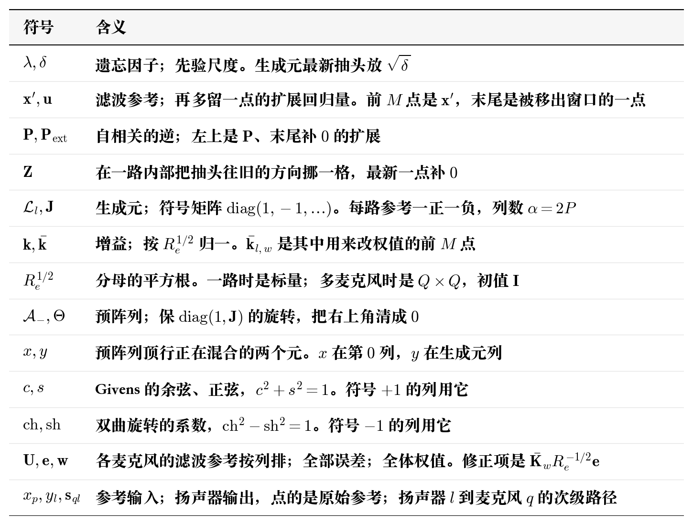

# 快速阵列 RLS

基于矩阵求逆引理把求逆换成自相关的逆之后，每个扬声器仍要存一份满阵 $\mathbf{P}$，再用它去乘滤波参考才得到增益，所以虽然转为递推形式，但是计算量仍然十分恐怖。

但是可以好好想想自相关矩阵的本质，虽然看似是期望，但是实际应用中使用的其实是时间序列。延迟线每一点只移一格，还留在窗口里的那些抽头，上一点已经算过，移位对齐之后可以直接复用。对不齐的只有刚进来的样本和被移出窗口的样本。所以我们只需要更新这两个而不需要再做满阵运算。基于这个思路得到的优化算法就是 fast-array rls。

文献是 R. Fraanje、A. H. Sayed、M. Verhaegen、N. J. Doelman，*A fast-array Kalman filter solution to active noise control*，*International Journal of Adaptive Control and Signal Processing*，2005，19（2–3）：125–152。

ps:公式推导只是按照自己的理解进行简化版的推导，也许并不严谨。

## 1. 数学模型

**符号**

我们先把上面推导的递推迭代公式写出来，一路参考的长度是 $M$ 时，它的递推是

$$
\begin{aligned}
\mathbf{k}
&=\frac{\mathbf{P}_{-}\mathbf{x}'}{\lambda+(\mathbf{x}')^{\mathsf T}\mathbf{P}_{-}\mathbf{x}'}\\
\mathbf{P}
&=\lambda^{-1}\bigl(\mathbf{P}_{-}-\mathbf{k}\,(\mathbf{x}')^{\mathsf T}\mathbf{P}_{-}\bigr)
\end{aligned}
$$

把这一路在末尾补一点 $0$，嵌成 $(M+1)\times(M+1)$ 的扩展自相关逆。左上 $M\times M$ 就是 $\mathbf{P}$

$$
\mathbf{P}_{\mathrm{ext}}
=\begin{bmatrix}\mathbf{P}&\mathbf{0}\\\mathbf{0}^{\mathsf T}&0\end{bmatrix}
$$

移位 $\mathbf{Z}$ 在这一路内部把抽头往旧的方向挪一格，最新一点补 $0$

$$
(\mathbf{Z}\mathbf{v})_{0}=0,\qquad
(\mathbf{Z}\mathbf{v})_{i}=v_{i-1},\quad i=1,\ldots,M
$$

上一次迭代的扩展矩阵被 $\mathbf{Z}$ 挪到右下角，左上那块 $\mathbf{P}_{-}$ 整块落下去

$$
\mathbf{Z}\mathbf{P}_{\mathrm{ext},-}\mathbf{Z}^{\mathsf T}
=\begin{bmatrix}0&\mathbf{0}^{\mathsf T}\\\mathbf{0}&\mathbf{P}_{-}\end{bmatrix}
$$

扩展自相关逆前后两次迭代的差就是

$$
\mathbf{P}_{\mathrm{ext}}-\mathbf{Z}\mathbf{P}_{\mathrm{ext},-}\mathbf{Z}^{\mathsf T}
=\begin{bmatrix}\mathbf{P}&\mathbf{0}\\\mathbf{0}^{\mathsf T}&0\end{bmatrix}
-\begin{bmatrix}0&\mathbf{0}^{\mathsf T}\\\mathbf{0}&\mathbf{P}_{-}\end{bmatrix}
$$

举个最简单的例子，取 $\lambda=1$、$\mathbf{P}_{-}=\delta\mathbf{I}$、$M=2$ 把这个差算出来

$$
\begin{bmatrix}\delta&0&0\\0&\delta&0\\0&0&0\end{bmatrix}
-\begin{bmatrix}0&0&0\\0&\delta&0\\0&0&\delta\end{bmatrix}
=\begin{bmatrix}\delta&0&0\\0&0&0\\0&0&-\delta\end{bmatrix}
$$

右下角的 $-\delta$ 是上一点控制窗口的最后一点。$\mathbf{Z}$ 把它移出了左上的 $\mathbf{P}$，差里留着这一点，这里就可以看到，我们得到了拓展矩阵之间的差异值。这个差的秩是 $2$，写成两列

$$
\begin{bmatrix}\delta&0&0\\0&0&0\\0&0&-\delta\end{bmatrix}
=\mathcal{L}\,\mathbf{J}\,\mathcal{L}^{\mathsf T},\qquad
\mathbf{J}=\mathrm{diag}(1,-1),\qquad
\mathcal{L}
=\sqrt{\delta}\begin{bmatrix}1&0\\0&0\\0&1\end{bmatrix}
$$

第一列符号 $+1$，在新进来的抽头上。第二列符号 $-1$，在被移出控制窗口的那一点上。回归量以后每一点只移一格，新样本补在开头，最旧的一点被 $\mathbf{Z}$ 移出，差的秩保持为 $2$，符号仍是这一正一负。推广到一般长度上就是

$$
\mathbf{P}_{\mathrm{ext}}-\mathbf{Z}\mathbf{P}_{\mathrm{ext},-}\mathbf{Z}^{\mathsf T}
=\mathcal{L}_l\,\mathbf{J}\,\mathcal{L}_l^{\mathsf T}
$$

$\mathcal{L}_l$ 称为生成元。以后只更新这两列即可实现迭代，不再需要更新满阵 $\mathbf{P}$。$P$ 路各自一对，$\mathbf{J}=\mathrm{diag}(1,-1,1,-1,\ldots)$。第 $p$ 路占第 $2p$、$2p+1$ 列，只在该路的 $M+1$ 行里非零：第 $2p$ 列符号 $+1$，放新进来的样本；第 $2p+1$ 列符号 $-1$，放被移出去的样本。满阵 $\mathbf{P}$ 有 $(PM)^{2}$ 个数，生成元只有 $P(M+1)\cdot 2P$ 个数。

得到矩阵迭代公式后，我们开始推导增益迭代公式，增益原始公式就是上面那一式

$$
\mathbf{k}
=\frac{\mathbf{P}_{-}\mathbf{x}'}{\lambda+(\mathbf{x}')^{\mathsf T}\mathbf{P}_{-}\mathbf{x}'}
$$

分母开方记成 $R_e^{1/2}=(\lambda+(\mathbf{x}')^{\mathsf T}\mathbf{P}_{-}\mathbf{x}')^{1/2}$。归一化增益

$$
\bar{\mathbf{k}}
=\frac{\mathbf{P}_{-}\mathbf{x}'}{R_e^{1/2}}
$$

于是 $\mathbf{k}=\bar{\mathbf{k}}/R_e^{1/2}$。分子是 $\mathbf{P}_{-}$ 乘这一点的 $\mathbf{x}'$。

上一次迭代的归一化增益满足 $\mathbf{P}_{--}\mathbf{x}'_{-}=R_{e,-}^{1/2}\bar{\mathbf{k}}_{-}$。嵌进扩展长度后，$\mathbf{Z}$ 把最新一点补 $0$、其余下移

$$
R_{e,-}^{1/2}\,\mathbf{Z}\bar{\mathbf{k}}_{-}
=\begin{bmatrix}0\\\mathbf{P}_{--}\mathbf{x}'_{-}\end{bmatrix}
$$

上一次迭代的生成元就是上一次迭代的扩展差

$$
\begin{bmatrix}\mathbf{P}_{-}&\mathbf{0}\\\mathbf{0}^{\mathsf T}&0\end{bmatrix}
-\begin{bmatrix}0&\mathbf{0}^{\mathsf T}\\\mathbf{0}&\mathbf{P}_{--}\end{bmatrix}
=\mathcal{L}_{-}\,\mathbf{J}\,\mathcal{L}_{-}^{\mathsf T}
$$

右乘扩展回归量 $\mathbf{u}$。它的前 $M$ 点是这一点的 $\mathbf{x}'$，末尾是刚移出控制窗口的那一点

$$
\begin{bmatrix}\mathbf{P}_{-}\mathbf{x}'\\0\end{bmatrix}
-\begin{bmatrix}0\\\mathbf{P}_{--}\mathbf{x}'_{-}\end{bmatrix}
=\mathcal{L}_{-}\,\mathbf{J}\,(\mathcal{L}_{-}^{\mathsf T}\mathbf{u})
$$

两式相加，分子落在前 $M$ 点上

$$
\begin{bmatrix}\mathbf{P}_{-}\mathbf{x}'\\0\end{bmatrix}
=R_{e,-}^{1/2}\,\mathbf{Z}\bar{\mathbf{k}}_{-}
+\mathcal{L}_{-}\,\mathbf{J}\,(\mathcal{L}_{-}^{\mathsf T}\mathbf{u})
$$

分母是同一组系数对 $\mathrm{diag}(1,\mathbf{J})$ 的二次型。上一次迭代的分母里的 $({(\mathbf{x}')_{-}})^{\mathsf T}\mathbf{P}_{--}\mathbf{x}'_{-}$ 被减掉，留下这一点的

$$
R_{e,-}+\mathbf{u}^{\mathsf T}\mathcal{L}_{-}\,\mathbf{J}\,\mathcal{L}_{-}^{\mathsf T}\mathbf{u}
=\lambda+(\mathbf{x}')^{\mathsf T}\mathbf{P}_{-}\mathbf{x}'
=R_e
$$

所以把 $R_{e,-}^{1/2}$、$\mathbf{Z}\bar{\mathbf{k}}_{-}$ 和 $\mathcal{L}_{-}$ 排成预阵列，行数 $1+P(M+1)$，列数 $1+2P$。$\lambda=1$ 时生成元列就是 $\mathcal{L}_{-}$；写成 $\lambda^{-1/2}\mathcal{L}_{-}$ 是让同一阵列带上遗忘。第 $0$ 列顶上是上一次迭代的 $R_e^{1/2}$，下面是上一次迭代的增益经过 $\mathbf{Z}$，每路最新一点为 $0$。其余列顶上是 $\mathbf{u}^{\mathsf T}\mathcal{L}_{-}$，预阵列记成

$$
\mathcal{A}_{-}
=\begin{bmatrix}
R_{e,-}^{1/2}&\mathbf{u}^{\mathsf T}\mathcal{L}_{-}\\
\mathbf{Z}\bar{\mathbf{k}}_{l,-}&\lambda^{-1/2}\mathcal{L}_{-}
\end{bmatrix}
$$

下一步要用 $R_e^{1/2}$、归一化增益和生成元。若存在满足

$$
\Theta\,\mathrm{diag}(1,\mathbf{J})\,\Theta^{\mathsf T}
=\mathrm{diag}(1,\mathbf{J})
$$

的 $\Theta$，令 $\mathcal{A}=\mathcal{A}_{-}\Theta$，则

$$
\begin{aligned}
\mathcal{A}\,\mathrm{diag}(1,\mathbf{J})\,\mathcal{A}^{\mathsf T}
&=\mathcal{A}_{-}\Theta\,\mathrm{diag}(1,\mathbf{J})\,\Theta^{\mathsf T}\mathcal{A}_{-}^{\mathsf T}\\
&=\mathcal{A}_{-}\,\mathrm{diag}(1,\mathbf{J})\,\mathcal{A}_{-}^{\mathsf T}
\end{aligned}
$$

所以乘完之后二次型不变，目标阵列的二次型必须等于预阵列的二次型。

先算预阵列的二次型。左上角是

$$
\begin{aligned}
&\bigl(\mathcal{A}_{-}\mathrm{diag}(1,\mathbf{J})\mathcal{A}_{-}^{\mathsf T}\bigr)_{00}\\
&=(R_{e,-}^{1/2})^{2}
+(\mathbf{u}^{\mathsf T}\mathcal{L}_{-})\,\mathbf{J}\,(\mathcal{L}_{-}^{\mathsf T}\mathbf{u})\\
&=R_{e,-}+\mathbf{u}^{\mathsf T}\mathcal{L}_{-}\,\mathbf{J}\,\mathcal{L}_{-}^{\mathsf T}\mathbf{u}\\
&=R_e
\end{aligned}
$$

第 $0$ 列下面，用前面的两式相加

$$
\begin{aligned}
&\bigl(\mathcal{A}_{-}\mathrm{diag}(1,\mathbf{J})\mathcal{A}_{-}^{\mathsf T}\bigr)_{\bullet 0}\\
&=R_{e,-}^{1/2}\,\mathbf{Z}\bar{\mathbf{k}}_{l,-}
+\lambda^{-1/2}\mathcal{L}_{-}\,\mathbf{J}\,(\mathcal{L}_{-}^{\mathsf T}\mathbf{u})\\
&=\begin{bmatrix}\mathbf{P}_{-}\mathbf{x}'\\0\end{bmatrix}
\end{aligned}
$$

右下是

$$
\begin{aligned}
&\bigl(\mathcal{A}_{-}\mathrm{diag}(1,\mathbf{J})\mathcal{A}_{-}^{\mathsf T}\bigr)_{\bullet\bullet}\\
&=\mathbf{Z}\bar{\mathbf{k}}_{l,-}\,(\mathbf{Z}\bar{\mathbf{k}}_{l,-})^{\mathsf T}
+\lambda^{-1}\mathcal{L}_{-}\,\mathbf{J}\,\mathcal{L}_{-}^{\mathsf T}
\end{aligned}
$$

二次型对称，右上是左下的转置。归一化增益 $\bar{\mathbf{k}}_l=\mathbf{P}_{-}\mathbf{x}'/R_e^{1/2}$ 嵌进扩展长度后末尾补 $0$，于是左下是 $R_e^{1/2}\bar{\mathbf{k}}_l$。合在一起

$$
\begin{aligned}
&\mathcal{A}_{-}\mathrm{diag}(1,\mathbf{J})\mathcal{A}_{-}^{\mathsf T}\\
&=
\begin{bmatrix}
R_e&
R_e^{1/2}\bar{\mathbf{k}}_l^{\mathsf T}\\
R_e^{1/2}\bar{\mathbf{k}}_l&
\mathbf{Z}\bar{\mathbf{k}}_{l,-}\,(\mathbf{Z}\bar{\mathbf{k}}_{l,-})^{\mathsf T}
+\lambda^{-1}\mathcal{L}_{-}\,\mathbf{J}\,\mathcal{L}_{-}^{\mathsf T}
\end{bmatrix}
\end{aligned}
$$

先令 $\lambda=1$。权值更新是 $\mathbf{P}=\mathbf{P}_{-}-\bar{\mathbf{k}}_{l,w}\bar{\mathbf{k}}_{l,w}^{\mathsf T}$，$\bar{\mathbf{k}}_{l,w}$ 是 $\bar{\mathbf{k}}_l$ 的前 $M$ 点，$\bar{\mathbf{k}}_l$ 末尾是 $0$，外积只落在扩展矩阵左上。于是

$$
\begin{aligned}
\mathbf{P}_{\mathrm{ext}}-\mathbf{Z}\mathbf{P}_{\mathrm{ext},-}\mathbf{Z}^{\mathsf T}
&=
\begin{bmatrix}\mathbf{P}&\mathbf{0}\\\mathbf{0}^{\mathsf T}&0\end{bmatrix}
-
\begin{bmatrix}0&\mathbf{0}^{\mathsf T}\\\mathbf{0}&\mathbf{P}_{-}\end{bmatrix}\\
&=
\begin{bmatrix}\mathbf{P}_{-}&\mathbf{0}\\\mathbf{0}^{\mathsf T}&0\end{bmatrix}
-
\begin{bmatrix}0&\mathbf{0}^{\mathsf T}\\\mathbf{0}&\mathbf{P}_{-}\end{bmatrix}
-\bar{\mathbf{k}}_l\bar{\mathbf{k}}_l^{\mathsf T}
\end{aligned}
$$

上一次生成元是

$$
\begin{bmatrix}\mathbf{P}_{-}&\mathbf{0}\\\mathbf{0}^{\mathsf T}&0\end{bmatrix}
-
\begin{bmatrix}0&\mathbf{0}^{\mathsf T}\\\mathbf{0}&\mathbf{P}_{--}\end{bmatrix}
=\mathcal{L}_{-}\,\mathbf{J}\,\mathcal{L}_{-}^{\mathsf T}
$$

两式相减，差出右下角的 $\mathbf{P}_{-}-\mathbf{P}_{--}$。上一次同样有 $\mathbf{P}_{-}=\mathbf{P}_{--}-\bar{\mathbf{k}}_{l,-,w}\bar{\mathbf{k}}_{l,-,w}^{\mathsf T}$，嵌进扩展长度并经 $\mathbf{Z}$ 下移之后，外积正好是 $\mathbf{Z}\bar{\mathbf{k}}_{l,-}\,(\mathbf{Z}\bar{\mathbf{k}}_{l,-})^{\mathsf T}$。所以

$$
\begin{bmatrix}\mathbf{P}_{-}&\mathbf{0}\\\mathbf{0}^{\mathsf T}&0\end{bmatrix}
-
\begin{bmatrix}0&\mathbf{0}^{\mathsf T}\\\mathbf{0}&\mathbf{P}_{-}\end{bmatrix}
=\mathcal{L}_{-}\,\mathbf{J}\,\mathcal{L}_{-}^{\mathsf T}
+\mathbf{Z}\bar{\mathbf{k}}_{l,-}\,(\mathbf{Z}\bar{\mathbf{k}}_{l,-})^{\mathsf T}
$$

代回扩展差，第 1 节生成元的定义是这个差写成 $\mathcal{L}_l\,\mathbf{J}\,\mathcal{L}_l^{\mathsf T}$，于是

$$
\begin{aligned}
\mathbf{P}_{\mathrm{ext}}-\mathbf{Z}\mathbf{P}_{\mathrm{ext},-}\mathbf{Z}^{\mathsf T}
&=\mathbf{Z}\bar{\mathbf{k}}_{l,-}\,(\mathbf{Z}\bar{\mathbf{k}}_{l,-})^{\mathsf T}
+\mathcal{L}_{-}\,\mathbf{J}\,\mathcal{L}_{-}^{\mathsf T}
-\bar{\mathbf{k}}_l\bar{\mathbf{k}}_l^{\mathsf T}\\
&=\mathcal{L}_l\,\mathbf{J}\,\mathcal{L}_l^{\mathsf T}
\end{aligned}
$$

移项得到

$$
\mathbf{Z}\bar{\mathbf{k}}_{l,-}\,(\mathbf{Z}\bar{\mathbf{k}}_{l,-})^{\mathsf T}
+\mathcal{L}_{-}\,\mathbf{J}\,\mathcal{L}_{-}^{\mathsf T}
=\bar{\mathbf{k}}_l\bar{\mathbf{k}}_l^{\mathsf T}+\mathcal{L}_l\,\mathbf{J}\,\mathcal{L}_l^{\mathsf T}
$$

$\lambda\neq 1$ 时权值更新多一个 $\lambda^{-1}$，预阵列右下用 $\lambda^{-1/2}\mathcal{L}_{-}$，外积前多 $\lambda^{-1}$，对齐方式相同。把四块合起来，目标二次型就是

$$
\begin{bmatrix}
R_e&
R_e^{1/2}\bar{\mathbf{k}}_l^{\mathsf T}\\
R_e^{1/2}\bar{\mathbf{k}}_l&
\bar{\mathbf{k}}_l\bar{\mathbf{k}}_l^{\mathsf T}+\mathcal{L}_l\,\mathbf{J}\,\mathcal{L}_l^{\mathsf T}
\end{bmatrix}
$$

在 $\mathcal{B}\,\mathrm{diag}(1,\mathbf{J})\,\mathcal{B}^{\mathsf T}$ 条件下满足该形式的矩阵 $\mathcal{B}$ 有无数个。迭代里真正要用的是 $R_e^{1/2}$、$\bar{\mathbf{k}}_l$ 和 $\mathcal{L}_l$，所以在这些解里挑右上为 $\mathbf{0}$ 的那一个，把目标阵列定成

$$
\mathcal{A}
=\begin{bmatrix}
R_e^{1/2}&\mathbf{0}\\
\bar{\mathbf{k}}_l&\mathcal{L}_l
\end{bmatrix}
$$

右上是 $\mathbf{0}$，表示生成元列不再往分母上贡献；左下是增益，右下是下一步还要接着转的生成元。直接乘可以核验它的二次型就是上面那一块。现在构造保签名的 $\Theta$，使 $\mathcal{A}_{-}\Theta$ 落到这个形状。

$\Theta$ 是一串小块的乘积。第 $a$ 个小块只动第 $0$ 列和第 $1+a$ 列，其余列不动。顶上两个数记成 $x$、$y$，也就是当前第 $0$ 列顶和第 $1+a$ 列顶。符号 $+1$ 时取 Givens

$$
c=\frac{x}{\sqrt{x^{2}+y^{2}}},\qquad
s=\frac{y}{\sqrt{x^{2}+y^{2}}},\qquad
\mathbf{M}_{+}
=\begin{bmatrix}c&-s\\ s&c\end{bmatrix}
$$

它满足 $-sx+cy=0$，所以

$$
\begin{bmatrix}x&y\end{bmatrix}\mathbf{M}_{+}
=\begin{bmatrix}\sqrt{x^{2}+y^{2}}&0\end{bmatrix}
$$

符号 $-1$ 时取双曲旋转

$$
\mathrm{ch}
=\frac{|x|}{\sqrt{x^{2}-y^{2}}},\qquad
\mathrm{sh}
=\frac{y}{x}\,\mathrm{ch},\qquad
\mathbf{M}_{-}
=\begin{bmatrix}\mathrm{ch}&-\mathrm{sh}\\ -\mathrm{sh}&\mathrm{ch}\end{bmatrix}
$$

顶上变成 $\bigl(\sqrt{x^{2}-y^{2}},\,0\bigr)$。整列按同一组 $c,s$ 或 $\mathrm{ch},\mathrm{sh}$ 变换：第 $0$ 列和第 $1+a$ 列的每一行都右乘这个 $2\times 2$。先对全部 $+1$ 列做 Givens，再对全部 $-1$ 列做双曲旋转；后一次乘时，第 $0$ 列顶用前一次改写后的值。全部乘完，右上整行是 $0$，左上是 $R_e^{1/2}$，左下是 $\bar{\mathbf{k}}_l$，右下是 $\mathcal{L}_l$。

全部扬声器共用一套预阵列。左上角从 $1\times 1$ 换成 $Q\times Q$ 的 $R_e^{1/2}$，每一行对应一只误差麦克风。滤波参考按麦克风排成 $Q$ 列，第 $q$ 列把各扬声器经 $\mathbf{s}_{ql}$ 卷出来的参考接在一起。生成元列带的 $\lambda^{-1/2}$ 乘在全体权值上，修正项用全部误差

$$
\mathbf{w}
\leftarrow\lambda^{-1/2}\mathbf{w}
+\bar{\mathbf{K}}_w R_e^{-1/2}\mathbf{e}
$$

$\mathbf{e}$ 的长度是 $Q$。$\lambda=1$ 时 $\lambda^{-1/2}=1$。按扬声器把 $\mathbf{w}$ 和 $\bar{\mathbf{K}}_w$ 切开，第 $l$ 块就是这只扬声器对全部参考的抽头，它乘到每一只麦克风。

输入是参考 $x_p$ 和全部误差麦克风 $e_q$，输出是扬声器 $y_l$。每一次迭代先按每条路径做参考信号预滤波，再转这一只联合预阵列，用 $R_e^{-1/2}\mathbf{e}$ 写全部扬声器，最后计算输出。滤波参考 $\mathbf{u}_{ql}$ 是参考卷 $\mathbf{s}_{ql}$，窗口多留一点，$\mathbf{x}'$ 取每路前 $M$ 点。

$$
\begin{aligned}
(\mathbf{u}_{ql,p})_{m}
&=\sum_{k=0}^{M_s-1}s_{ql,k}\,x_p(n-m-k)\\
\begin{bmatrix}
R_e^{1/2}&\mathbf{0}\\
\bar{\mathbf{K}}&\mathcal{L}
\end{bmatrix}
&\leftarrow
\begin{bmatrix}
R_{e,-}^{1/2}&\mathbf{U}^{\mathsf T}\mathcal{L}_{-}\\
\mathbf{Z}\bar{\mathbf{K}}_{-}&\lambda^{-1/2}\mathcal{L}_{-}
\end{bmatrix}
\Theta\\
\mathbf{w}
&\leftarrow\lambda^{-1/2}\mathbf{w}
+\bar{\mathbf{K}}_w R_e^{-1/2}\mathbf{e}\\
y_l
&=\mathbf{w}_l^{\mathsf T}\mathbf{x}
\end{aligned}
$$

$\mathbf{U}$ 的第 $q$ 列是麦克风 $q$ 上各扬声器的滤波参考。第 $a$ 个生成元列的符号仍是第 1 节的 $+1$ 或 $-1$，这一列要和左上角的每一行各转一次，把这一列在前 $Q$ 行里的元清成 0。初值 $R_e^{1/2}=\mathbf{I}$，$\bar{\mathbf{K}}=\mathbf{0}$，$\mathbf{w}=\mathbf{0}$。生成元仍按扬声器、参考把 $\sqrt{\delta}$ 放在最新抽头。

## 2. 实例

$P=1$，$L=2$，$Q=2$，$M=1$，$M_s=2$，$\lambda=1$，$\delta=1$。分母常数是 1，$R_e^{1/2}$ 从 $\mathbf{I}$ 起算。四条路径

$$
\mathbf{s}_{00}=\mathbf{s}_{01}=\mathbf{s}_{11}=\begin{bmatrix}0\\1\end{bmatrix},\qquad
\mathbf{s}_{10}=\begin{bmatrix}0\\0\end{bmatrix}
$$

输入是参考 $x$ 和误差 $\mathbf{e}$。第 0 点

$$
x=1,\qquad
\mathbf{e}=\begin{bmatrix}1\\1\end{bmatrix}
$$

$s_{ql,0}=0$，当前参考还没进滤波窗口，滤波参考全是 0。预阵列生成元列的顶是 0，旋转不改 $R_e^{1/2}$ 和增益。权值保持 0。用更新后的权值点参考

$$
y_0=0,\qquad y_1=0
$$

第 1 点输入仍是

$$
x=1,\qquad
\mathbf{e}=\begin{bmatrix}1\\1\end{bmatrix}
$$

上一点参考是 1，滤波结果取 $s_{ql,1}$，所以 $\mathbf{s}_{ql}=[0,1]^{\mathsf T}$ 的路径上 $u=1$，$\mathbf{s}_{10}$ 上 $u=0$。两只麦克风一起转完，和滤波 RLS 的实例是同一组增益

$$
w_0=\frac{1}{5},\qquad w_1=\frac{3}{5}
$$

第 0 只扬声器只接上麦克风 0，第 1 只扬声器接上两只麦克风，两路误差都进了 $\mathbf{e}$。再用更新后的权值点当前参考

$$
y_0=\frac{1}{5},\qquad y_1=\frac{3}{5}
$$

## 3. 仿真

码仓：https://github.com/liang-nian/anc.git

### 3.1 函数对应的公式

`FarlsCreate` 按参考路数 $P$、扬声器路数 $L$、误差麦克风路数 $Q$、控制长度 $M$、次级路径长度 $M_s$、遗忘因子 $\lambda$、分母常数和 $\delta$ 建状态。次级路径按麦克风、扬声器、抽头排列。它不分配满阵 $\mathbf{P}$，全体扬声器共用一套生成元 $\mathcal{L}$、归一化增益 $\bar{\mathbf{K}}$ 和 $Q\times Q$ 的 $R_e^{1/2}$。$R_e^{1/2}$ 从分母常数的平方根乘单位阵起算，本仿真这个常数是 $1$，所以从 $\mathbf{I}$ 起算。生成元按第 1 节的位置放 $\sqrt{\delta}$。滤波参考的系数是 $s_{ql,k}\lambda^{-k/2}$。权值按下标 $(lP+p)M+k$ 排，$k=0$ 是当前抽头。

一个采样点调用一次 `FarlsCore`。它里面按顺序对照第 1 节末尾那一组。

先推进各路参考，按每条路径做滤波参考，拼成 $\mathbf{U}$。第 $q$ 列是麦克风 $q$ 上各扬声器的滤波参考

$$
(\mathbf{u}_{ql,p})_{m}
=\sum_{k=0}^{M_s-1}s_{ql,k}\lambda^{-k/2}\,x_p(n-m-k)
$$

组预阵列并右乘 $\Theta$。左上角放上一步的 $R_e^{1/2}$，右上是 $\mathbf{U}^{\mathsf T}\mathcal{L}_{-}$，左下是移位后的 $\bar{\mathbf{K}}_{-}$，右下是 $\lambda^{-1/2}\mathcal{L}_{-}$。每个生成元列和左上角每一行各转一次：$+1$ 列做 Givens，$-1$ 列做双曲旋转

$$
\begin{bmatrix}
R_e^{1/2}&\mathbf{0}\\
\bar{\mathbf{K}}&\mathcal{L}
\end{bmatrix}
\leftarrow
\begin{bmatrix}
R_{e,-}^{1/2}&\mathbf{U}^{\mathsf T}\mathcal{L}_{-}\\
\mathbf{Z}\bar{\mathbf{K}}_{-}&\lambda^{-1/2}\mathcal{L}_{-}
\end{bmatrix}
\Theta
$$

转完写出新的 $R_e^{1/2}$、$\bar{\mathbf{K}}$ 和 $\mathcal{L}$。用 $R_e^{1/2}$ 解出 $R_e^{-1/2}\mathbf{e}$，再改全部权值

$$
\mathbf{w}
\leftarrow\lambda^{-1/2}\mathbf{w}
+\bar{\mathbf{K}}_w R_e^{-1/2}\mathbf{e}
$$

$\bar{\mathbf{K}}_w$ 是 $\bar{\mathbf{K}}$ 里对应控制抽头的那一段。最后用更新后的权值点原始参考

$$
y_l=\mathbf{w}_l^{\mathsf T}\mathbf{x}
$$

`FarlsCopyWeights` 的排列是扬声器、参考、抽头，抽头下标 0 是当前抽头。

### 3.2 仿真设计

参考、纯净目标信号和 $\mathbf{b}$ 与滤波 RLS 相同。四条次级路径和 FxLMS 那一章相同。$f_s=2000\,\mathrm{Hz}$，$N_{\mathrm{sim}}=16000$，种子 7。$P=2$，$L=2$，$Q=2$，$M=8$，$M_s=3$。$\lambda=1$，$\delta=1$。分母常数取 $1$，$R_e^{1/2}$ 从 $1$ 起算。

$$
\begin{aligned}
\mathbf{s}_{00}&=\begin{bmatrix}0&0.90&0.20\end{bmatrix}^{\mathsf T}\\
\mathbf{s}_{01}&=\begin{bmatrix}0&0.15&0.05\end{bmatrix}^{\mathsf T}\\
\mathbf{s}_{10}&=\begin{bmatrix}0&0.12&-0.04\end{bmatrix}^{\mathsf T}\\
\mathbf{s}_{11}&=\begin{bmatrix}0&0.85&0.15\end{bmatrix}^{\mathsf T}
\end{aligned}
$$

### 3.3 仿真结果

波形取记录末尾 $150\,\mathrm{ms}$。功率曲线是整段 $8\,\mathrm{s}$ 上、$0.2\,\mathrm{s}$ 滑动平均后的误差功率。功率谱取末尾 $4\,\mathrm{s}$。误差 NMSE 用末尾 $2\,\mathrm{s}$。系数取整段跑完之后的值，和 $\mathbf{b}$ 比较。

**「两路参考信号」**：黑线是通道 0，大约在 $-2.4$ 到 $3$；蓝线是通道 1，大约在 $-1.7$ 到 $2.4$。阶次的起伏还在，上面叠着各自的白噪声。

**「两路纯净目标信号」**：两路都是标准差 0.25 的白噪声，这一段大约在 $-0.9$ 到 $0.7$。

**「两路目标信号」**：通道 0 大约在 $-3.4$ 到 $3.6$，通道 1 大约在 $-2.2$ 到 $2.2$。里面是参考经主路径之后的成分，再加纯净目标信号。主路径先过了次级路径，串路的那两条也加在里面。

**「两路误差功率往纯净目标信号靠拢」**：红线和黄线很快贴上大约 $-12.1\,\mathrm{dB}$ 的青绿虚线，之后在虚线附近抖动。虚线是两路纯净目标信号的平均功率。

**「收敛后，通道 0 的误差贴住纯净目标信号」**：紫线是通道 0 的目标信号。红线是抵消后，青绿虚线是纯净目标信号，两条叠在大约 $-0.9$ 到 $0.7$。末尾 $2\,\mathrm{s}$ 里，通道 0 的 NMSE 是 $1.10\times 10^{-3}$，通道 1 是 $1.68\times 10^{-3}$。

**「通道 0 的阶次被消掉之后，剩下的谱就是纯净目标信号」**：紫线在 40、80、120、160 Hz 有四个峰。红线和青绿虚线贴在一条平线上，四个峰消失。

**「四条控制滤波器收敛到 b」**：圆点是 $\mathbf{b}$，叉号是估计。四条 FIR 都落到圆点上，系数 NMSE 是 $5.74\times 10^{-4}$。

**「收敛系数减去 b」**：各抽头的差都在 $\pm 0.017$ 以内。

## 4. 补充

### 4.1 $\Theta$ 的 $2\times 3$ 例子

光看推导可能还是比较抽象，举个简单的例子说明。要同时有 $+1$ 和 $-1$ 两列，列数至少是 $3$；行数至少 $2$。签名 $\mathbf{J}=\mathrm{diag}(1,-1)$，预阵列

$$
\mathcal{A}_{-}
=\begin{bmatrix}3&4&3\\1&2&1\end{bmatrix}
$$

先算预阵列二次型，$\mathrm{diag}(1,\mathbf{J})=\mathrm{diag}(1,1,-1)$，

$$
\begin{aligned}
\mathcal{A}_{-}\,\mathrm{diag}(1,\mathbf{J})\,\mathcal{A}_{-}^{\mathsf T}
&=
\begin{bmatrix}3&4&3\\1&2&1\end{bmatrix}
\begin{bmatrix}1&0&0\\0&1&0\\0&0&-1\end{bmatrix}
\begin{bmatrix}3&1\\4&2\\3&1\end{bmatrix}
=
\begin{bmatrix}16&8\\8&4\end{bmatrix}
\end{aligned}
$$

先对 $+1$ 列做 Givens，$x=3$，$y=4$，

$$
c=\frac{3}{5},\qquad s=\frac{4}{5},\qquad
\mathbf{M}_{+}
=\begin{bmatrix}3/5&-4/5\\ 4/5&3/5\end{bmatrix}
$$

第 $0$、第 $1$ 列右乘 $\mathbf{M}_{+}$，第 $2$ 列不动

$$
\mathcal{A}_{1}
=\begin{bmatrix}5&0&3\\11/5&2/5&1\end{bmatrix}
$$

核对二次型

$$
\mathcal{A}_{1}\,\mathrm{diag}(1,\mathbf{J})\,\mathcal{A}_{1}^{\mathsf T}
=\begin{bmatrix}16&8\\8&4\end{bmatrix}
$$

再对 $-1$ 列做双曲旋转，此时 $x=5$，$y=3$，

$$
\mathrm{ch}=\frac{5}{4},\qquad
\mathrm{sh}=\frac{3}{4},\qquad
\mathbf{M}_{-}
=\begin{bmatrix}5/4&-3/4\\ -3/4&5/4\end{bmatrix}
$$

第 $0$、第 $2$ 列右乘 $\mathbf{M}_{-}$，第 $1$ 列不动

$$
\mathcal{A}
=\begin{bmatrix}4&0&0\\2&2/5&-2/5\end{bmatrix}
$$

右上两元都是 $0$，落到目标形状。再核对二次型

$$
\mathcal{A}\,\mathrm{diag}(1,\mathbf{J})\,\mathcal{A}^{\mathsf T}
=\begin{bmatrix}16&8\\8&4\end{bmatrix}
$$

和预阵列那一块相同。

### 4.2 参数

只是改进了计算方法，不影响参数结论，所以和前一章的结论是一致的。
