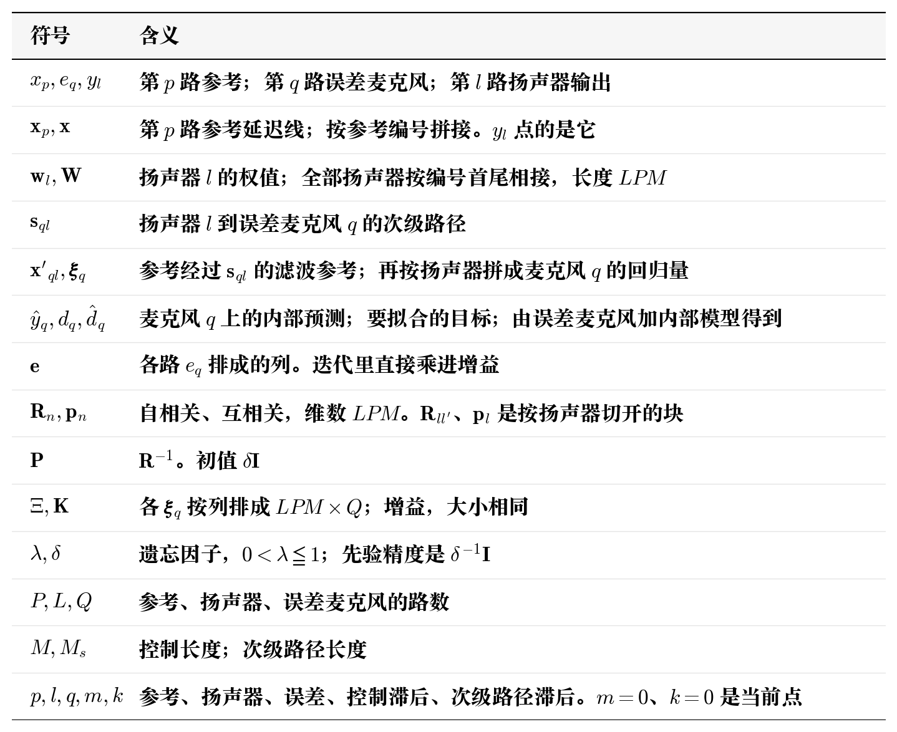
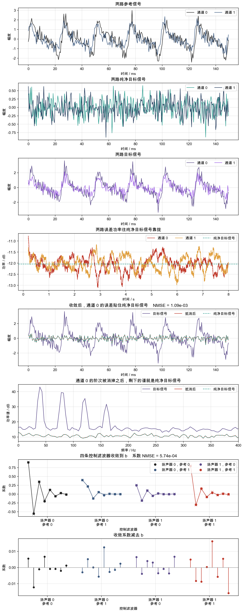

# 滤波 RLS

仍然要进行次级路径建模，这里直接从多通道进行推导。文献仍是 Simon Haykin, *Adaptive Filter Theory*, Prentice Hall。这里从多通道的参考和误差麦克风写起，把次级路径放进损失函数，再解出扬声器输出，。直接推导多通道看着会比较复杂，但实际上和 FxLMS 算法类似，最终的更新公式可以理解为就是参考信号预滤波之后的公式。

ps:公式推导只是按照自己的理解进行简化版的推导，也许并不严谨。

## 1. 数学模型

**符号**

同理，一切数学建模都从变量抽象开始到损失函数结束。输入是 $P$ 路参考 $x_p(n)$ 和 $Q$ 路误差麦克风 $e_q(n)$。输出是 $L$ 路扬声器 $y_l(n)$。

第 $p$ 路参考的延迟线，最新一点在下标 $0$

$$
\mathbf{x}_p(n)
=\begin{bmatrix}x_p(n)&x_p(n-1)&\cdots&x_p(n-M+1)\end{bmatrix}^{\mathsf T}
$$

$P$ 路按编号 $0,\ldots,P-1$ 首尾相接。没有用到的参考填 $0$。长度 $PM$

$$
\mathbf{x}(n)
=\begin{bmatrix}\mathbf{x}_0(n)\\\vdots\\\mathbf{x}_{P-1}(n)\end{bmatrix}
$$

扬声器 $l$ 的权值用同一套下标。第 $p$ 段、段内第 $m$ 个元素是扬声器 $l$ 对第 $p$ 路参考、滞后 $m$ 的系数。全部扬声器再按 $l=0,\ldots,L-1$ 首尾相接，长度 $LPM$

$$
\mathbf{w}_l
=\begin{bmatrix}\mathbf{w}_{l0}\\\vdots\\\mathbf{w}_{l,P-1}\end{bmatrix},\qquad
\mathbf{W}
=\begin{bmatrix}\mathbf{w}_0\\\vdots\\\mathbf{w}_{L-1}\end{bmatrix}
$$

$\mathbf{W}$ 里扬声器 $l$ 占下标 $lPM$ 到 $(l+1)PM-1$。该段内部，参考 $p$、滞后 $m$ 的下标是 $lPM+pM+m$。

损失要对权值求导，所以次级路径改卷在参考上。路径 $\mathbf{s}_{ql}$、参考 $p$、控制滞后 $m$ 的抽头是

$$
(\mathbf{x}'_{ql,p}(n))_{m}
=\sum_{k=0}^{M_s-1}s_{ql,k}\,x_p(n-m-k)
$$

再按参考编号拼成与 $\mathbf{x}$ 相同的顺序，长度 $PM$

$$
\mathbf{x}'_{ql}(n)
=\begin{bmatrix}\mathbf{x}'_{ql,0}(n)\\\vdots\\\mathbf{x}'_{ql,P-1}(n)\end{bmatrix}
$$

麦克风 $q$ 上，每个扬声器各有一条这样的滤波参考。按扬声器编号拼成一条，顺序与 $\mathbf{W}$ 里的 $\mathbf{w}_l$ 对齐，长度 $LPM$

$$
\boldsymbol{\xi}_q(n)
=\begin{bmatrix}\mathbf{x}'_{q0}(n)\\\vdots\\\mathbf{x}'_{q,L-1}(n)\end{bmatrix}
$$

于是全部扬声器在麦克风 $q$ 上的线性预测是 $\mathbf{W}^{\mathsf T}\boldsymbol{\xi}_q$。已经发出的 $y_l(n-k)=\mathbf{w}_l^{\mathsf T}\mathbf{x}(n-k)$，交换求和

$$
\hat{y}_q
=\sum_{l=0}^{L-1}\mathbf{w}_l^{\mathsf T}\mathbf{x}'_{ql}
=\mathbf{W}^{\mathsf T}\boldsymbol{\xi}_q
$$

因此，可以得到误差的表达式

$$
e_q
=d_q-\hat{y}_q
=d_q-\mathbf{W}^{\mathsf T}\boldsymbol{\xi}_q
$$

这就是损失函数中的误差信号。到时刻 $n$ 为止，每一路麦克风都放进 RLS 的指数加权损失。$\mathbf{W}_{-1}=\mathbf{0}$，先验精度是 $\delta^{-1}\mathbf{I}$

$$
\begin{aligned}
J_n(\mathbf{W})
&=\sum_{i=0}^{n}\lambda^{n-i}\sum_{q=0}^{Q-1}e_q(i)^{2}\\
&\quad+\lambda^{n+1}\mathbf{W}^{\mathsf T}(\delta^{-1}\mathbf{I})\mathbf{W}\\
&=\sum_{i=0}^{n}\lambda^{n-i}\sum_{q=0}^{Q-1}
\bigl(d_q(i)-\mathbf{W}^{\mathsf T}\boldsymbol{\xi}_q(i)\bigr)^{2}\\
&\quad+\lambda^{n+1}\mathbf{W}^{\mathsf T}(\delta^{-1}\mathbf{I})\mathbf{W}
\end{aligned}
$$

对 $\mathbf{W}$ 求导并令梯度为零，得到法方程 $\mathbf{R}_n\mathbf{W}_n=\mathbf{p}_n$

$$
\begin{aligned}
\mathbf{R}_n
&=\lambda^{n+1}\delta^{-1}\mathbf{I}
+\sum_{i=0}^{n}\lambda^{n-i}\sum_{q=0}^{Q-1}
\boldsymbol{\xi}_q(i)\boldsymbol{\xi}_q^{\mathsf T}(i)\\
\mathbf{p}_n
&=\sum_{i=0}^{n}\lambda^{n-i}\sum_{q=0}^{Q-1}
\hat{d}_q(i)\,\boldsymbol{\xi}_q(i)
\end{aligned}
$$

$\mathbf{R}_n$ 是 $LPM\times LPM$。按扬声器切成 $L\times L$ 块，每块 $PM\times PM$。第 $(l,l')$ 块的第 $(pM+m)$ 行、第 $(rM+k)$ 列，是扬声器 $l$ 的参考 $p$ 滞后 $m$，与扬声器 $l'$ 的参考 $r$ 滞后 $k$，在全部麦克风上的加权相关。右端 $\mathbf{p}_n$ 同样按扬声器切开，$\mathbf{p}_l$ 的长度是 $PM$，下标顺序与 $\mathbf{w}_l$ 相同。逐点写成，遗忘每一点只乘一次，这一点的 $Q$ 个麦克风都加进去

$$
\begin{aligned}
\mathbf{R}_{ll'}
&\leftarrow\lambda\mathbf{R}_{ll'}
+\sum_{q=0}^{Q-1}\mathbf{x}'_{ql}(\mathbf{x}'_{ql'})^{\mathsf T}\\
\mathbf{p}_l
&\leftarrow\lambda\mathbf{p}_l
+\sum_{q=0}^{Q-1}\hat{d}_q\,\mathbf{x}'_{ql}
\end{aligned}
$$

初值 $\mathbf{R}_{ll}=\delta^{-1}\mathbf{I}$，非对角块为 $\mathbf{0}$。这里的 $\hat{d}_q$ 对应 RLS 写进互相关的 $d$，是回归量要拟合的目标，由误差麦克风加内部模型得到。解是

$$
\sum_{l'=0}^{L-1}\mathbf{R}_{ll'}\,\mathbf{w}_{l'}=\mathbf{p}_l
$$

解出的 $\mathbf{w}_l$ 立刻用于这一点的输出，点的是原始参考

$$
y_l=\mathbf{w}_l^{\mathsf T}\mathbf{x}
$$

由此我们得到了迭代公式，$\boldsymbol{\Xi}$ 的第 $q$ 列是 $\boldsymbol{\xi}_q$，$\mathbf{e}$ 的第 $q$ 个元是 $e_q$。由此得到迭代公式

$$
\begin{aligned}
e_q
&=d_q-\mathbf{W}^{\mathsf T}\boldsymbol{\xi}_q\\
\mathbf{K}
&=\mathbf{P}\,\boldsymbol{\Xi}
\bigl(\lambda\mathbf{I}+\boldsymbol{\Xi}^{\mathsf T}\mathbf{P}\boldsymbol{\Xi}\bigr)^{-1}\\
\mathbf{W}
&\leftarrow\mathbf{W}+\mathbf{K}\,\mathbf{e}\\
\mathbf{P}
&\leftarrow\lambda^{-1}\bigl(
\mathbf{P}-\mathbf{K}\,\boldsymbol{\Xi}^{\mathsf T}\mathbf{P}
\bigr)\\
y_l
&=\mathbf{w}_l^{\mathsf T}\mathbf{x}
\end{aligned}
$$

## 2. 实例

取 $P=1$，$L=2$，$Q=2$，$M=1$，$M_s=2$，$\lambda=1$，$\delta=1$。四条次级路径

$$
\begin{aligned}
\mathbf{s}_{00}&=\begin{bmatrix}0\\1\end{bmatrix},&
\mathbf{s}_{01}&=\begin{bmatrix}0\\1\end{bmatrix},&
\mathbf{s}_{10}&=\begin{bmatrix}0\\0\end{bmatrix},&
\mathbf{s}_{11}&=\begin{bmatrix}0\\1\end{bmatrix}
\end{aligned}
$$

权值初值 0，整块 $\mathbf{P}$ 初值 $\mathbf{I}$。两只扬声器的抽头合成 $\mathbf{W}$，两路误差合成 $\mathbf{e}$。输入是这一路参考和两路误差麦克风。写进增益的是采集到的 $\mathbf{e}$。输出是更新之后用原始参考点出来的扬声器。

第 0 点参考是 $1$，误差是 $[1,1]^{\mathsf T}$。每条 $\mathbf{s}_{ql}$ 的第 0 个抽头都是 0，参考延迟线是空的，四条滤波参考都是 0，$\boldsymbol{\Xi}=\mathbf{0}$。增益是 0，两只扬声器的权值停在 0。再点原始参考，输出也是 0

$$
y_0=0,\qquad y_1=0
$$

第 1 点参考仍是 $1$，误差仍是 $[1,1]^{\mathsf T}$。上一点参考是 1，滤波结果是 $s_{ql,1}$

$$
\begin{aligned}
\mathbf{e}&=\begin{bmatrix}1\\1\end{bmatrix}\\
\boldsymbol{\xi}_0&=\begin{bmatrix}1\\1\end{bmatrix},\qquad
\boldsymbol{\xi}_1=\begin{bmatrix}0\\1\end{bmatrix},\qquad
\boldsymbol{\Xi}=\begin{bmatrix}1&0\\1&1\end{bmatrix}
\end{aligned}
$$

$$
\boldsymbol{\Xi}^{\mathsf T}\mathbf{P}\boldsymbol{\Xi}
=\begin{bmatrix}2&1\\1&1\end{bmatrix},\qquad
\lambda\mathbf{I}+\boldsymbol{\Xi}^{\mathsf T}\mathbf{P}\boldsymbol{\Xi}
=\begin{bmatrix}3&1\\1&2\end{bmatrix}
$$

$$
\mathbf{K}
=\boldsymbol{\Xi}
\begin{bmatrix}3&1\\1&2\end{bmatrix}^{-1}
=\frac{1}{5}\begin{bmatrix}2&-1\\1&2\end{bmatrix}
$$

两路误差一起写进两只扬声器

$$
\begin{aligned}
w_0
&\leftarrow\frac{2}{5}e_0-\frac{1}{5}e_1
=\frac{1}{5}\\
w_1
&\leftarrow\frac{1}{5}e_0+\frac{2}{5}e_1
=\frac{3}{5}
\end{aligned}
$$

$\mathbf{s}_{10}=\mathbf{0}$，麦克风 1 的滤波参考里没有扬声器 0。$e_1$ 仍然通过上面这个 $2\times 2$ 的逆进了 $w_0$。$\mathbf{P}$ 的交叉项也被填上

$$
\mathbf{P}
\leftarrow\mathbf{P}-\mathbf{K}\,\boldsymbol{\Xi}^{\mathsf T}\mathbf{P}
=\begin{bmatrix}3/5&-1/5\\-1/5&2/5\end{bmatrix}
$$

再用更新后的权值点当前参考 $1$

$$
y_0=\frac{1}{5},\qquad y_1=\frac{3}{5}
$$

## 3. 仿真

码仓：https://github.com/liang-nian/anc.git

### 3.1 函数对应的公式

`FrlsCreate` 按参考路数 $P$、扬声器路数 $L$、误差路数 $Q$、控制长度 $M$、次级路径长度 $M_s$、遗忘因子 $\lambda$、分母上单独传入的正数和权值初值方差 $\delta$ 建状态。次级路径按麦克风、扬声器抄进来，一共 $QL$ 条。滤波参考按麦克风、扬声器、参考各留一条延迟线。$\mathbf{P}$ 是一整块 $LPM\times LPM$，初值 $\delta\mathbf{I}$。滤波参考的系数是 $s_{ql,k}\lambda^{-k/2}$。权值按下标 $(lP+p)M+k$ 排，$k=0$ 是当前抽头。

一个采样点调用一次 `FrlsCore`。它里面按顺序对照第 1 节的迭代。

先推进各路参考，按每条 $\mathbf{s}_{ql}$ 做滤波参考，拼成 $\boldsymbol{\Xi}$。第 $q$ 列是 $\boldsymbol{\xi}_q$，内部按扬声器、参考、滞后对齐 $\mathbf{W}$

$$
(\mathbf{x}'_{ql,p})_{m}
=\sum_{k=0}^{M_s-1}s_{ql,k}\lambda^{-k/2}\,x_p(n-m-k)
$$

写进增益的是送进来的 $\mathbf{e}$。分母常数记成代码里单独传入的正数，仿真取 $1$，对应公式里的 $\lambda$。增益、权值和协方差

$$
\begin{aligned}
\mathbf{K}
&=\mathbf{P}\,\boldsymbol{\Xi}
\bigl(\mathrm{meas}\,\mathbf{I}+\boldsymbol{\Xi}^{\mathsf T}\mathbf{P}\boldsymbol{\Xi}\bigr)^{-1}\\
\mathbf{W}
&\leftarrow\lambda^{-1/2}\mathbf{W}+\lambda^{-1/2}\mathbf{K}\,\mathbf{e}\\
\mathbf{P}
&\leftarrow\lambda^{-1}\bigl(\mathbf{P}-\mathbf{K}\,\boldsymbol{\Xi}^{\mathsf T}\mathbf{P}\bigr)
\end{aligned}
$$

代码先算 $\mathbf{P}\boldsymbol{\Xi}$，再拼分母矩阵并求逆得到 $\mathbf{K}$；权值先乘 $\lambda^{-1/2}$，再加上 $\lambda^{-1/2}\mathbf{K}\mathbf{e}$。$\lambda=1$ 时这两处都是 $1$，和第 1 节 $\mathbf{W}\leftarrow\mathbf{W}+\mathbf{K}\mathbf{e}$ 相同。

最后用更新后的权值点原始参考

$$
y_l=\mathbf{w}_l^{\mathsf T}\mathbf{x}
$$

`FrlsCopyWeights` 的排列是扬声器、参考、抽头，抽头下标 0 是当前点。

### 3.2 仿真设计

采样率 $f_s=2000\,\mathrm{Hz}$，$N_{\mathrm{sim}}=16000$，随机数种子为 7。$P=2$，$L=2$，$Q=2$，$M=8$，$M_s=3$。$\lambda=1$，$\delta=1$。增益分母里的常数取 $1$，和 $\lambda$ 相同。

两路参考都是 40、80、120、160 Hz 四个阶次。通道 0 的幅度是 1、0.7、0.45、0.25，通道 1 是 0.75、0.55、0.30、0.20，相位错开 0.6。每路再加标准差 0.35 的白噪声。纯净目标信号两路独立，标准差都是 0.25。四条次级路径和 FxLMS 那一章相同，第 0 个抽头是 0，扬声器之间互相串路

$$
\begin{aligned}
\mathbf{s}_{00}&=\begin{bmatrix}0&0.90&0.20\end{bmatrix}^{\mathsf T}\\
\mathbf{s}_{01}&=\begin{bmatrix}0&0.15&0.05\end{bmatrix}^{\mathsf T}\\
\mathbf{s}_{10}&=\begin{bmatrix}0&0.12&-0.04\end{bmatrix}^{\mathsf T}\\
\mathbf{s}_{11}&=\begin{bmatrix}0&0.85&0.15\end{bmatrix}^{\mathsf T}
\end{aligned}
$$

当前扬声器不影响当前误差。每只扬声器要收敛到的系数和 FxLMS 那一章相同

$$
\begin{aligned}
\mathbf{b}_{00}&=\begin{bmatrix}0.9&-0.55&0.35&-0.2&0.12&-0.06&0.03&-0.01\end{bmatrix}^{\mathsf T}\\
\mathbf{b}_{01}&=\begin{bmatrix}0.4&0.22&-0.12&0.06&-0.03&0.01&0&0\end{bmatrix}^{\mathsf T}\\
\mathbf{b}_{10}&=\begin{bmatrix}0.25&-0.18&0.10&-0.05&0.02&0&0&0\end{bmatrix}^{\mathsf T}\\
\mathbf{b}_{11}&=\begin{bmatrix}0.8&-0.30&0.16&-0.08&0.04&-0.02&0.01&0\end{bmatrix}^{\mathsf T}
\end{aligned}
$$

主路径是 $\mathbf{s}$ 和对应 $\mathbf{b}_{lp}$ 的卷积。目标信号是参考经过主路径，再加上纯净目标信号。

### 3.3 仿真结果

波形取记录末尾 $150\,\mathrm{ms}$。功率曲线是整段 $8\,\mathrm{s}$ 上、$0.2\,\mathrm{s}$ 滑动平均后的误差功率。功率谱取末尾 $4\,\mathrm{s}$。误差 NMSE 用末尾 $2\,\mathrm{s}$。系数取整段跑完之后的值，和 $\mathbf{b}$ 比较。

**「两路参考信号」**：黑线是通道 0，大约在 $-2.4$ 到 $3$；蓝线是通道 1，大约在 $-1.7$ 到 $2.4$。阶次的起伏还在，上面叠着各自的白噪声。

**「两路纯净目标信号」**：两路都是标准差 0.25 的白噪声，这一段大约在 $-0.9$ 到 $0.7$。

**「两路目标信号」**：通道 0 大约在 $-3.4$ 到 $3.6$，通道 1 大约在 $-2.2$ 到 $2.2$。里面是参考经主路径之后的成分，再加纯净目标信号。主路径先过了次级路径，串路的那两条也加在里面。

**「两路误差功率往纯净目标信号靠拢」**：红线和黄线很快贴上大约 $-12.1\,\mathrm{dB}$ 的青绿虚线，之后在虚线附近抖动。虚线是两路纯净目标信号的平均功率。

**「收敛后，通道 0 的误差贴住纯净目标信号」**：紫线是通道 0 的目标信号。红线是抵消后，青绿虚线是纯净目标信号，两条叠在大约 $-0.9$ 到 $0.7$。末尾 $2\,\mathrm{s}$ 里，通道 0 的 NMSE 是 $1.10\times 10^{-3}$，通道 1 是 $1.68\times 10^{-3}$。

**「通道 0 的阶次被消掉之后，剩下的谱就是纯净目标信号」**：紫线在 40、80、120、160 Hz 有四个峰。红线和青绿虚线贴在一条平线上，四个峰消失。

**「四条控制滤波器收敛到 b」**：圆点是 $\mathbf{b}$，叉号是估计。四条 FIR 都落到圆点上，系数 NMSE 是 $5.74\times 10^{-4}$。

**「收敛系数减去 b」**：各抽头的差都在 $\pm 0.017$ 以内。

## 4. 补充

### 4.1 **遗忘因子 $\lambda$，$0<\lambda\le 1$。**

$\lambda=1$ 时每一点权重都是 $1$，和整段最小二乘相同。$\lambda=0.99$ 时，距当前 $100$ 点的权重是 $0.99^{100}\approx 0.37$；$0.999$ 时，距当前 $1000$ 点的权重也大约是 $0.37$。有效记忆大约是 $1/(1-\lambda)$ 点，其实就是指数加权平均的统计式。路径平稳时把 $\lambda$ 放在 $1$ 或紧贴 $1$。路径在变时再往下调，跟踪变快，误差地板抬高。$\mathbf{P}$ 的更新每一步乘 $\lambda^{-1}$，$\lambda$ 明显小于 $1$ 时 $\mathbf{P}$ 的量级抬高，增益保持得比较大，稳态抖动变大。

代码里 $\lambda$ 还乘在两处。权值在加上增益项之前乘 $\lambda^{-1/2}$，滤波参考用的次级路径第 $k$ 个抽头是 $s_{ql,k}\lambda^{-k/2}$。$\lambda=1$ 时两处都是 $1$，滤波参考用的就是这组 $\mathbf{s}_{ql}$，增益和迭代公式一致。$\lambda<1$ 时，越旧的次级路径抽头被抬得越高，用来对齐指数窗里被压低的旧样本。

### 4.2 **初值 $\delta$。** 

$\mathbf{P}$ 从 $\delta\mathbf{I}$ 起算，损失里的先验精度是 $\delta^{-1}$。第一步 $\mathbf{P}$ 还是 $\delta\mathbf{I}$，分母常数取 $1$ 时增益是

$$
\mathbf{K}
=\delta\,\boldsymbol{\Xi}
\bigl(\mathbf{I}+\delta\,\boldsymbol{\Xi}^{\mathsf T}\boldsymbol{\Xi}\bigr)^{-1}
$$

它是 $LPM\times Q$，每一列对应一路误差麦克风。实例里 $\delta=1$，两路误差都是 1，结果是 $w_0=1/5$、$w_1=3/5$，两路误差都进了两只扬声器。$\delta$ 很大时 $\mathbf{K}$ 靠近 $\boldsymbol{\Xi}(\boldsymbol{\Xi}^{\mathsf T}\boldsymbol{\Xi})^{-1}$，第一步更猛。$\delta$ 很小，$\mathbf{K}$ 按 $\delta$ 缩小，开头很多点权值几乎不动。参考已经有能量而系数还贴在 $0$ 上，就把 $\delta$ 加大。开头几步系数冲过 $\mathbf{b}$、误差先放大再回来，就把 $\delta$ 减小。零空间里的抽头也被 $\delta$ 按向 $0$，$\delta$ 越大这个约束越松。

### 4.3 分母常数

第 1 节的分母是 $\lambda\mathbf{I}+\boldsymbol{\Xi}^{\mathsf T}\mathbf{P}\boldsymbol{\Xi}$。代码在 $\lambda$ 的位置放了一个单独传入的正数。它越大，同样的 $\mathbf{P}$ 和滤波参考算出的增益越小，更新越慢。它越小，增益越大，开头越猛。仿真里它取 $1$，和 $\lambda$ 相同。调试时先让它等于 $\lambda$。路径大致正确、增益仍然过猛时，再把它加大一点，用来压增益。
