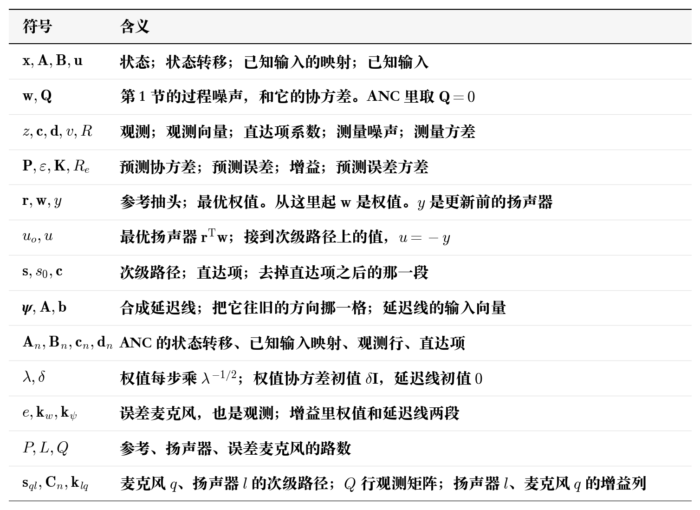

# 卡尔曼滤波主动降噪

LMS 和 RLS 是很常见的 ANC 解决方案，但也有一些其他的有趣的算法，同样可以应用在 ANC，比如格型滤波器，又比如知名的卡尔曼滤波器。把最优控制滤波器的系数本身当成待估状态，用卡尔曼滤波做估计。本章按 R. Fraanje、A. H. Sayed、M. Verhaegen、N. J. Doelman 的 *A fast-array Kalman filter solution to active noise control*，*International Journal of Adaptive Control and Signal Processing*，2005，19（2–3）：125–152 里的协方差递推来写。基础模型仍是前馈：参考传感器采参考，算法算扬声器，扬声器经过次级路径到误差传感器，和目标信号相减。

ps:公式推导只是按照自己的理解进行简化版的推导，也许并不严谨。

## 1. 卡尔曼滤波

**符号**

卡尔曼滤波的视角和维纳滤波不同，他是从系统的角度出发的。一个系统，有着一个输入，一个状态和一个输出，系统的状态因为输入而改变，系统输出则来自于对状态的观测和输入的直达。从这个建模角度出发，卡尔曼滤波存在许多不同的范式，可以应用在非常广泛的领域，这里只对下面 ANC 使用的一种范式作讲解。

状态 $\mathbf{x}(n)$ 是 $N\times 1$。状态转移方程记录状态的更新方式，它按线性关系往前走，存在过程噪声 $\mathbf{w}(n)$

$$
\mathbf{x}(n+1)=\mathbf{A}(n)\mathbf{x}(n)+\mathbf{B}(n)\mathbf{u}(n)+\mathbf{w}(n)
$$

$\mathbf{A}(n)$ 是 $N\times N$ 的状态转移矩阵。$\mathbf{u}(n)$ 是已知输入，维数 $m\times 1$。$\mathbf{B}(n)$ 是 $N\times m$，把已知输入映射到状态。$\mathbf{w}(n)$ 是 $N\times 1$，均值是 0 的白噪声，协方差 $\mathbf{Q}(n)$ 是 $N\times N$ 矩阵

$$
\mathrm{E}[\mathbf{w}(n)]=\mathbf{0},\qquad
\mathrm{E}[\mathbf{w}(n)\mathbf{w}^{\mathsf T}(n)]=\mathbf{Q}(n)
$$

观测在本章是一个标量 $z(n)$。观测向量 $\mathbf{c}(n)$ 是 $N\times 1$。已知输入还可以不经过状态，直接进观测，这一项叫直达项，系数 $\mathbf{d}(n)$ 是 $m\times 1$。测量噪声 $v(n)$ 是标量，方差 $R>0$

$$
z(n)=\mathbf{c}^{\mathsf T}(n)\mathbf{x}(n)+\mathbf{d}^{\mathsf T}(n)\mathbf{u}(n)+v(n)
$$

$$
\mathrm{E}[v(n)]=0,\qquad
\mathrm{E}[v^{2}(n)]=R,\qquad
\mathrm{E}[\mathbf{w}(n)\,v(n)]=\mathbf{0}
$$

$v(n)$ 和状态也不相关。当状态估计 $\hat{\mathbf{x}}$ 收敛到真实状态 $\mathbf{x}$ 时，这个模型得到的观测是 $\mathbf{c}^{\mathsf T}\hat{\mathbf{x}}+\mathbf{d}^{\mathsf T}\mathbf{u}$。实际观测减去它

$$
z-\mathbf{c}^{\mathsf T}\hat{\mathbf{x}}-\mathbf{d}^{\mathsf T}\mathbf{u}
=\mathbf{c}^{\mathsf T}(\mathbf{x}-\hat{\mathbf{x}})+v
=v
$$

只剩测量噪声，方差是 $R$，由于测量噪声和状态不相关，状态收敛无法消除这个噪声，而这就是卡尔曼滤波模型的收敛目标。

得到数学建模之后，我们需要考虑如何使状态误差逐步收敛减小。状态预测误差和协方差是

$$
\begin{aligned}
\tilde{\mathbf{x}}(n)&=\mathbf{x}(n)-\hat{\mathbf{x}}(n)\\
\mathbf{P}(n)&=\mathrm{E}\bigl[\tilde{\mathbf{x}}(n)\tilde{\mathbf{x}}^{\mathsf T}(n)\bigr]
\end{aligned}
$$

$\mathbf{P}(n)$ 是 $N\times N$，对称，半正定。初值是 $\hat{\mathbf{x}}(0)$ 和 $\mathbf{P}(0)$。

但实际上我们不知道真实的目标状态值是什么，所以无法通过这条公式直接计算得到误差量，实际上如果可以得到目标值，整个模型都失去意义了，这个时候卡尔曼滤波会通过观测值来统计误差信息。观测到 $z(n)$ 之后，要估的是状态预测误差 $\tilde{\mathbf{x}}=\mathbf{x}-\hat{\mathbf{x}}$。把观测拆开

$$
\begin{aligned}
z&=\mathbf{c}^{\mathsf T}\mathbf{x}+\mathbf{d}^{\mathsf T}\mathbf{u}+v\\
&=\mathbf{c}^{\mathsf T}\hat{\mathbf{x}}+\mathbf{d}^{\mathsf T}\mathbf{u}+\mathbf{c}^{\mathsf T}\tilde{\mathbf{x}}+v
\end{aligned}
$$

$\mathbf{c}^{\mathsf T}\hat{\mathbf{x}}$ 和直达项 $\mathbf{d}^{\mathsf T}\mathbf{u}$ 在都是已知值，剩下的一段就是预测误差

$$
\varepsilon=z-\mathbf{c}^{\mathsf T}\hat{\mathbf{x}}-\mathbf{d}^{\mathsf T}\mathbf{u}=\mathbf{c}^{\mathsf T}\tilde{\mathbf{x}}+v
$$

直得到误差之后，我们的目标是减小他，在 LMS 算法里面我们采用梯度下降法使得误差逐步减小，而卡尔曼滤波里面我们的思路更加简单粗暴一些，我们直接尝试将误差补偿回去。$\varepsilon$ 是标量，对状态预测误差做线性估计，就是用一个 $N\times 1$ 的增益去乘它，$\widehat{\tilde{\mathbf{x}}}=\mathbf{K}\varepsilon$。加回预测，得到修正后的状态

$$
\hat{\mathbf{x}}(n|n)=\hat{\mathbf{x}}(n)+\mathbf{K}(n)\,\varepsilon(n)
$$

$\mathbf{K}$ 取使均方误差最小的值，现在的问题是如何求解它，在部分资料里面这部分推导十分拗口，因为他使用了步进法来模拟梯度下降过程进行最优解分析，但是可以直接用矩阵求导梯度 0 最优解求解。修正后的误差记成 $\mathbf{e}=\tilde{\mathbf{x}}-\mathbf{K}\varepsilon$，均方误差是

$$
\begin{aligned}
J
&=\mathrm{E}[\mathbf{e}^{\mathsf T}\mathbf{e}]\\
&=\mathrm{E}\bigl[(\tilde{\mathbf{x}}-\mathbf{K}\varepsilon)^{\mathsf T}(\tilde{\mathbf{x}}-\mathbf{K}\varepsilon)\bigr]\\
&=\mathrm{E}[\tilde{\mathbf{x}}^{\mathsf T}\tilde{\mathbf{x}}]
-2\mathbf{K}^{\mathsf T}\mathrm{E}[\tilde{\mathbf{x}}\,\varepsilon]
+\mathrm{E}[\varepsilon^{2}]\,\mathbf{K}^{\mathsf T}\mathbf{K}
\end{aligned}
$$

对 $\mathbf{K}$ 求梯度，令梯度等于 0

$$
\frac{\partial J}{\partial\mathbf{K}}
=-2\mathrm{E}[\tilde{\mathbf{x}}\,\varepsilon]+2\mathrm{E}[\varepsilon^{2}]\,\mathbf{K}
=\mathbf{0}
$$

于是

$$
\mathbf{K}=\frac{\mathrm{E}[\tilde{\mathbf{x}}\,\varepsilon]}{\mathrm{E}[\varepsilon^{2}]}
$$

$\mathrm{E}[\varepsilon^{2}]$ 记成 $R_e$。把 $\varepsilon=\mathbf{c}^{\mathsf T}\tilde{\mathbf{x}}+v$ 代进去，$v$ 和 $\tilde{\mathbf{x}}$ 不相关，$\mathrm{E}[\tilde{\mathbf{x}}\,v]=\mathbf{0}$

$$
\begin{aligned}
\mathrm{E}[\tilde{\mathbf{x}}\,\varepsilon]
&=\mathrm{E}[\tilde{\mathbf{x}}\tilde{\mathbf{x}}^{\mathsf T}]\mathbf{c}
=\mathbf{P}\mathbf{c}\\
R_e&=\mathbf{c}^{\mathsf T}\mathbf{P}\mathbf{c}+R\\
\mathbf{K}&=\frac{\mathbf{P}\mathbf{c}}{R_e}
\end{aligned}
$$

对当前状态更新后的结果进行误差分析，求得后验误差把状态预测误差和测量噪声都带上

$$
\mathbf{x}(n)-\hat{\mathbf{x}}(n|n)
=(\mathbf{I}-\mathbf{K}\mathbf{c}^{\mathsf T})\tilde{\mathbf{x}}
-\mathbf{K}\,v
$$

$v$ 和 $\tilde{\mathbf{x}}$ 不相关，后验协方差是

$$
\begin{aligned}
\mathbf{P}^{+}
&=(\mathbf{I}-\mathbf{K}\mathbf{c}^{\mathsf T})\mathbf{P}(\mathbf{I}-\mathbf{K}\mathbf{c}^{\mathsf T})^{\mathsf T}
+R\,\mathbf{K}\mathbf{K}^{\mathsf T}\\
&=\mathbf{P}-\mathbf{K}\mathbf{c}^{\mathsf T}\mathbf{P}-\mathbf{P}\mathbf{c}\,\mathbf{K}^{\mathsf T}
+\mathbf{K}(\mathbf{c}^{\mathsf T}\mathbf{P}\mathbf{c}+R)\mathbf{K}^{\mathsf T}
\end{aligned}
$$

括号里就是上面的预测误差方差 $R_e$。$\mathbf{c}^{\mathsf T}\mathbf{P}\mathbf{c}$ 是状态不确定度投到观测方向上的大小，$R$ 是测量噪声自己的方差。已知

$$
\mathbf{K}=\frac{\mathbf{P}\mathbf{c}}{R_e}
$$

代回去。$\mathbf{K}\mathbf{c}^{\mathsf T}\mathbf{P}$、$\mathbf{P}\mathbf{c}\,\mathbf{K}^{\mathsf T}$ 和 $R_e\mathbf{K}\mathbf{K}^{\mathsf T}$ 都等于 $\mathbf{P}\mathbf{c}\,\mathbf{c}^{\mathsf T}\mathbf{P}/R_e$。展开式里这三项抵掉两项

$$
\mathbf{P}^{+}
=\mathbf{P}-\frac{\mathbf{P}\mathbf{c}\,\mathbf{c}^{\mathsf T}\mathbf{P}}{R_e}
=(\mathbf{I}-\mathbf{K}\mathbf{c}^{\mathsf T})\mathbf{P}
$$

下一步迭代中，预测用这一次迭代得到的后验估计 $\mathbf{A}$ 进行迭代，已知输入照加

$$
\begin{aligned}
\hat{\mathbf{x}}(n+1)
&=\mathbf{A}\,\hat{\mathbf{x}}(n|n)+\mathbf{B}\mathbf{u}\\
&=\mathbf{A}\hat{\mathbf{x}}+\mathbf{B}\mathbf{u}+\mathbf{A}\mathbf{K}\,\varepsilon
\end{aligned}
$$

记 $\mathbf{k}=\mathbf{A}\mathbf{P}\mathbf{c}$，它是 $N\times 1$。由 $\mathbf{K}=\mathbf{P}\mathbf{c}/R_e$ 得到 $\mathbf{A}\mathbf{K}=\mathbf{k}/R_e$，所以

$$
\hat{\mathbf{x}}(n+1)
=\mathbf{A}\hat{\mathbf{x}}+\mathbf{B}\mathbf{u}+\frac{\mathbf{k}}{R_e}\,\varepsilon
$$

由于误差也会经由状态转移方程进行传播，因此预测协方差是后验协方差经过 $\mathbf{A}$，再叠上过程噪声

$$
\begin{aligned}
\mathbf{P}(n+1)
&=\mathbf{A}\mathbf{P}^{+}\mathbf{A}^{\mathsf T}+\mathbf{Q}\\
&=\mathbf{A}\mathbf{P}\mathbf{A}^{\mathsf T}-\frac{1}{R_e}\mathbf{k}\mathbf{k}^{\mathsf T}+\mathbf{Q}
\end{aligned}
$$

至此我们得到了一个循环迭代公式，把时刻写回去，每来一个观测就做这一组

$$
\begin{aligned}
\varepsilon(n)&=z(n)-\mathbf{c}^{\mathsf T}(n)\hat{\mathbf{x}}(n)-\mathbf{d}^{\mathsf T}(n)\mathbf{u}(n)\\
R_e(n)&=R+\mathbf{c}^{\mathsf T}(n)\mathbf{P}(n)\mathbf{c}(n)\\
\mathbf{k}(n)&=\mathbf{A}(n)\mathbf{P}(n)\mathbf{c}(n)\\
\hat{\mathbf{x}}(n+1)
&=\mathbf{A}(n)\hat{\mathbf{x}}(n)+\mathbf{B}(n)\mathbf{u}(n)
+\frac{\mathbf{k}(n)}{R_e(n)}\,\varepsilon(n)\\
\mathbf{P}(n+1)
&=\mathbf{A}(n)\mathbf{P}(n)\mathbf{A}^{\mathsf T}(n)
-\frac{1}{R_e(n)}\mathbf{k}(n)\mathbf{k}^{\mathsf T}(n)
+\mathbf{Q}(n)
\end{aligned}
$$

每一次迭代按这个顺序走：

1. 上一次迭代已经给出预测 $\hat{\mathbf{x}}(n)$、$\mathbf{P}(n)$
2. 这一次迭代看到观测，算出 $\varepsilon(n)$
3. 用最优 $\mathbf{K}(n)=\mathbf{P}(n)\mathbf{c}(n)/R_e(n)$ 得到 $\hat{\mathbf{x}}(n|n)$
4. 再推出下一次迭代的 $\hat{\mathbf{x}}(n+1)$、$\mathbf{P}(n+1)$

## 2. 数学模型

对照着第 1 节的模型，我们来一一对应建模 ANC 卡尔曼滤波算法。最优控制器是长度 $M$ 的 FIR，系数 $\mathbf{w}$。参考抽头最新的一点放在下标 0

$$
\mathbf{r}(n)=\begin{bmatrix}x(n)&x(n-1)&\cdots&x(n-M+1)\end{bmatrix}^{\mathsf T}
$$

最优扬声器输出、实际扬声器输出和实际接到次级路径上的值是

$$
\begin{aligned}
u_o(n)&=\mathbf{r}^{\mathsf T}(n)\mathbf{w}(n)\\
y(n)&=\hat{\mathbf{w}}^{\mathsf T}(n)\,\mathbf{r}(n)\\
u(n)&=-y(n)
\end{aligned}
$$

$y(n)$ 在看到当前误差之前就算出来。$u(n)$ 取负号，控制器反相接到次级路径上。

次级路径是 FIR，长度 $M_s$，系数 $\mathbf{s}=[s_0,s_1,\ldots,s_{M_s-1}]^{\mathsf T}$。$s_0$ 是直达项，其余收成行向量

$$
\mathbf{c}^{\mathsf T}=\begin{bmatrix}s_1&\cdots&s_{M_s-1}\end{bmatrix}
$$

这个 $\mathbf{c}$ 是路径系数。第一节的观测向量到下面记成 $\mathbf{c}_n$，由 $s_0\mathbf{r}^{\mathsf T}$ 和这个 $\mathbf{c}$ 拼成。

次级路径有两条状态。$\boldsymbol{\psi}_1$ 由 $u_o$ 驱动，$\boldsymbol{\psi}_2$ 由 $u$ 驱动。两条用同一组 $(\mathbf{A},\mathbf{b},\mathbf{c},s_0)$，合成

$$
\boldsymbol{\psi}(n)=\boldsymbol{\psi}_1(n)+\boldsymbol{\psi}_2(n)
$$

论文把这条合成状态记成 $\mathbf{y}$。这里记成 $\boldsymbol{\psi}$，免得和扬声器样本 $y(n)$ 混淆。长度 $M_s-1$，$\psi[0]$ 是上一时刻的合成输入，再往前的点依次后移

$$
\begin{aligned}
\psi_0(n+1)&=u_o(n)+u(n)\\
\psi_i(n+1)&=\psi_{i-1}(n),\quad i=1,\ldots,M_s-2
\end{aligned}
$$

写成 $\boldsymbol{\psi}(n+1)=\mathbf{A}\boldsymbol{\psi}(n)+\mathbf{b}\bigl(u_o(n)+u(n)\bigr)$。$\mathbf{b}=[1,0,\ldots,0]^{\mathsf T}$，$\mathbf{A}$ 把状态往旧的方向挪一格，第 0 个分量先清掉。

待估状态把最优权值和这条合成延迟线叠在一起

$$
\mathbf{x}(n)=\begin{bmatrix}\mathbf{w}(n)\\ \boldsymbol{\psi}(n)\end{bmatrix}
$$

权值的虚构模型是逐点乘 $\lambda^{-1/2}$，$0<\lambda\le 1$。$u_o=\mathbf{r}^{\mathsf T}\mathbf{w}$ 是状态的线性函数，收进状态转移。$u=-y$ 是已知输入，单独写成 $\mathbf{B}_n\hat{\mathbf{w}}$。第一节的已知输入 $\mathbf{u}$ 在这里就是正在发声的权值 $\hat{\mathbf{w}}$，$m=M$。状态转移方程是

$$
\begin{aligned}
\mathbf{A}_n
&=\begin{bmatrix}
\lambda^{-1/2}\mathbf{I}&\mathbf{0}\\
\mathbf{b}\,\mathbf{r}^{\mathsf T}(n)&\mathbf{A}
\end{bmatrix}\\
\mathbf{B}_n
&=\begin{bmatrix}
\mathbf{0}\\
-\mathbf{b}\,\mathbf{r}^{\mathsf T}(n)
\end{bmatrix}\\
\mathbf{x}(n+1)
&=\mathbf{A}_n\mathbf{x}(n)+\mathbf{B}_n\hat{\mathbf{w}}(n)
\end{aligned}
$$

主噪声和反相后的扬声器声压在误差麦克风上相加，再加上测量噪声 $v(n)$

$$
\begin{aligned}
d(n)&=s_0\,u_o(n)+\mathbf{c}^{\mathsf T}\boldsymbol{\psi}_1(n)\\
e(n)&=d(n)+s_0\,u(n)+\mathbf{c}^{\mathsf T}\boldsymbol{\psi}_2(n)+v(n)\\
&=s_0\bigl(u_o(n)+u(n)\bigr)+\mathbf{c}^{\mathsf T}\boldsymbol{\psi}(n)+v(n)\\
&=s_0\bigl(\mathbf{r}^{\mathsf T}(n)\mathbf{w}(n)-y(n)\bigr)+\mathbf{c}^{\mathsf T}\boldsymbol{\psi}(n)+v(n)
\end{aligned}
$$

$\mathbf{c}^{\mathsf T}\boldsymbol{\psi}$ 是两路尾部已经反相加过的声压。当前迭代的扬声器直达项 $-s_0 y(n)$ 由已知的 $\hat{\mathbf{w}}$ 决定，不放进状态。

观测行和直达项系数是

$$
\begin{aligned}
\mathbf{c}_n^{\mathsf T}
&=\begin{bmatrix}s_0\,\mathbf{r}^{\mathsf T}(n)&\mathbf{c}^{\mathsf T}\end{bmatrix}\\
\mathbf{d}_n^{\mathsf T}
&=-s_0\,\mathbf{r}^{\mathsf T}(n)
\end{aligned}
$$

麦克风读数写成状态与观测向量的乘积，加上这项已知直达项

$$
\begin{aligned}
e(n)
&=\mathbf{c}_n^{\mathsf T}\mathbf{x}(n)+\mathbf{d}_n^{\mathsf T}\hat{\mathbf{w}}(n)+v(n)\\
&=s_0\,\mathbf{r}^{\mathsf T}(n)\mathbf{w}(n)+\mathbf{c}^{\mathsf T}\boldsymbol{\psi}(n)-s_0\,y(n)+v(n)
\end{aligned}
$$

$s_0=0$ 时 $\mathbf{d}_n=\mathbf{0}$，乘积 $\mathbf{c}_n^{\mathsf T}\mathbf{x}(n)$ 本身就是去掉测量噪声之后的观测值，所以误差信号就是这个模型的观测值。

$\hat{\mathbf{w}}$ 在最近 $M_s$ 次迭代都等于 $\mathbf{w}$ 时，$u_o+u=0$，合成延迟线也保持为 0。观测值只剩干扰噪声

$$
e(n)=v(n)
$$

这就是收敛目标。既然已经知道状态，观测向量，状态转移方程以及观测值，直接套用上述推导的更新公式即可。过程噪声协方差取 $\mathbf{Q}=\mathbf{0}$，$R$ 是测量噪声方差，值得注意的是在 ANC 领域里面我们根本不知道这个方差值是多少，所以一般我们会把它当作调试参数来使用，$\mathbf{P}(n)$ 是预测协方差

$$
\begin{aligned}
\varepsilon(n)&=e(n)-\mathbf{c}^{\mathsf T}\hat{\boldsymbol{\psi}}(n)\\
R_e(n)&=R+\mathbf{c}_n^{\mathsf T}\mathbf{P}(n)\mathbf{c}_n\\
\mathbf{k}(n)&=\mathbf{A}_n\mathbf{P}(n)\mathbf{c}_n\\
\mathbf{P}(n+1)
&=\mathbf{A}_n\mathbf{P}(n)\mathbf{A}_n^{\mathsf T}
-\frac{1}{R_e(n)}\mathbf{k}(n)\mathbf{k}^{\mathsf T}(n)
\end{aligned}
$$

第一节的预测误差是 $z-\mathbf{c}^{\mathsf T}\hat{\mathbf{x}}-\mathbf{d}^{\mathsf T}\mathbf{u}$。这里 $z$ 是误差麦克风读数 $e$，估计器和发声用同一组 $\hat{\mathbf{w}}$，直达项对掉，只剩延迟线尾部 $\mathbf{c}^{\mathsf T}\hat{\boldsymbol{\psi}}$。

增益按权值和延迟线切开，$\mathbf{k}^{\mathsf T}=[\mathbf{k}_w^{\mathsf T},\mathbf{k}_\psi^{\mathsf T}]$。状态更新是

$$
\begin{aligned}
\hat{\mathbf{w}}(n+1)
&=\lambda^{-1/2}\hat{\mathbf{w}}(n)+\frac{\mathbf{k}_w(n)}{R_e(n)}\,\varepsilon(n)\\
\hat{\boldsymbol{\psi}}(n+1)
&=\mathbf{A}\hat{\boldsymbol{\psi}}(n)+\frac{\mathbf{k}_\psi(n)}{R_e(n)}\,\varepsilon(n)
\end{aligned}
$$

$\hat{\boldsymbol{\psi}}$ 的转移只留 $\mathbf{A}\hat{\boldsymbol{\psi}}$ 和增益项。控制输入 $\mathbf{b}\,y(n)$ 已经和最优路径里的对应项消掉了。

初值把权值那一块设成 $\delta\mathbf{I}$，延迟线那一块设成 0。本章把次级路径状态的过程噪声取 $\mathbf{Q}=\mathbf{0}$，延迟线协方差初值也取 0，此时算法有些类似于 RLS 算法，其实两种算法都是二阶算法。

多通道时参考 $P$ 路，扬声器 $L$ 只，误差麦克风 $Q$ 只。第 $l$ 只扬声器的状态仍是 $[\mathbf{w}_l;\boldsymbol{\psi}_l]$，全体接成一条 $\mathbf{x}$。次级路径按麦克风、扬声器写成 $\mathbf{s}_{ql}$，$\mathbf{c}_{ql}^{\mathsf T}$ 是它去掉直达项之后的那一段。观测矩阵 $\mathbf{C}_n$ 有 $Q$ 行，第 $q$ 行把各扬声器的 $s_{ql,0}\mathbf{r}^{\mathsf T}$ 和 $\mathbf{c}_{ql}^{\mathsf T}$ 接上。预测误差和增益都是对这 $Q$ 只麦克风一起算

$$
\begin{aligned}
\varepsilon_q(n)
&=e_q(n)-\sum_{l=0}^{L-1}\mathbf{c}_{ql}^{\mathsf T}\hat{\boldsymbol{\psi}}_l(n)\\
\mathbf{R}_e(n)
&=R\mathbf{I}+\mathbf{C}_n^{\mathsf T}\mathbf{P}(n)\mathbf{C}_n\\
\mathbf{K}(n)
&=\mathbf{A}_n\mathbf{P}(n)\mathbf{C}_n\mathbf{R}_e^{-1}(n)\\
\hat{\mathbf{w}}_l(n+1)
&=\lambda^{-1/2}\hat{\mathbf{w}}_l(n)
+\sum_{q=0}^{Q-1}\mathbf{k}_{lq}(n)\,\varepsilon_q(n)
\end{aligned}
$$

$\mathbf{k}_{lq}$ 是 $\mathbf{K}$ 里扬声器 $l$ 那一块、麦克风 $q$ 那一列。一只扬声器的全部参考抽头都乘到每一只误差麦克风。$Q=1$、$L=1$、$P=1$ 时这一组和上面的单通道公式是同一个更新。延迟线的移位同样留下 $\mathbf{A}\hat{\boldsymbol{\psi}}$ 和增益项，不把扬声器样本再写进去。

## 3. 实例

单通道，$M=2$，$M_s=2$，$\mathbf{s}=[0,1]^{\mathsf T}$，所以 $s_0=0$，$\mathbf{c}=1$，延迟线只有 1 点。$\lambda=1$，$R=1$，权值初值方差 $\delta=1$。$\hat{\mathbf{w}}(0)=\mathbf{0}$，$\hat\psi(0)=0$

$$
\mathbf{P}(0)=\begin{bmatrix}1&0&0\\0&1&0\\0&0&0\end{bmatrix}
$$

输入是参考 $x$ 和误差 $e$。第 0 点

$$
x=1,\qquad e=1
$$

参考抽头 $\mathbf{r}=[1,0]^{\mathsf T}$。观测行 $\mathbf{c}_0=[0,0,1]^{\mathsf T}$。$\mathbf{P}(0)\mathbf{c}_0=\mathbf{0}$，所以 $R_e(0)=1$，$\mathbf{k}(0)=\mathbf{0}$。预测误差 $\varepsilon=1$。增益是 0，权值和延迟线都停在 0。这一步的转移是

$$
\mathbf{A}_0=\begin{bmatrix}1&0&0\\0&1&0\\1&0&0\end{bmatrix}
$$

左下角那一行为 $\mathbf{r}^{\mathsf T}$。协方差变成

$$
\mathbf{P}(1)=\mathbf{A}_0\mathbf{P}(0)\mathbf{A}_0^{\mathsf T}
=\begin{bmatrix}1&0&1\\0&1&0\\1&0&1\end{bmatrix}
$$

互协方差出现了：第 0 个权值和延迟线现在相关。用更新后的权值点当前参考

$$
y=0
$$

第 1 点输入

$$
x=0,\qquad e=1
$$

参考抽头 $\mathbf{r}=[0,1]^{\mathsf T}$。观测行还是 $[0,0,1]^{\mathsf T}$

$$
\mathbf{P}(1)\mathbf{c}_1=\begin{bmatrix}1\\0\\1\end{bmatrix},\qquad
R_e(1)=1+1=2
$$

$$
\mathbf{A}_1=\begin{bmatrix}1&0&0\\0&1&0\\0&1&0\end{bmatrix},\qquad
\mathbf{k}(1)=\mathbf{A}_1\mathbf{P}(1)\mathbf{c}_1=\begin{bmatrix}1\\0\\0\end{bmatrix}
$$

$$
\frac{\mathbf{k}(1)}{R_e(1)}=\begin{bmatrix}1/2\\0\\0\end{bmatrix}
$$

预测误差仍是 1，于是

$$
\hat{\mathbf{w}}=\begin{bmatrix}1/2\\0\end{bmatrix},\qquad\hat\psi=0
$$

只有第 0 个抽头动了 $1/2$。它动的是上一时刻的参考：第 0 步把 $x=1$ 写进了互协方差，第 1 步误差才通过这条互协方差改到对应的权值上。再用更新后的权值点当前参考

$$
y=0
$$

## 4. 仿真

码仓：https://github.com/liang-nian/anc.git

### 4.1 函数对应的公式

`KfancCreate` 按参考路数 $P$、扬声器路数 $L$、误差麦克风路数 $Q$、控制长度 $M$、次级路径阶数 $M_s$、遗忘因子 $\lambda$、测量方差 $R$ 和权值初值方差 $\delta$ 建状态，并把次级路径抄进来。次级路径按麦克风、扬声器、抽头排列，抽头 0 是直达项 $s_0$。权值块协方差初值是 $\delta\mathbf{I}$，延迟线块初值是 0。权值按下标 $(lP+p)M+k$ 排，$k=0$ 是当前抽头。

一个采样点调用一次 `KfancCore`。它里面按顺序对照第 2 节的多通道公式。

先把各路参考推进抽头，拼成 $\mathbf{r}$。用更新前的 $\hat{\mathbf{w}}_l$ 算各扬声器输出并返回

$$
y_l=\hat{\mathbf{w}}_l^{\mathsf T}\mathbf{r}
$$

$y_l$ 在看到当前误差之前就算出来，和第 2 节一致。

再算各路预测误差。$\mathbf{c}_{ql}^{\mathsf T}$ 是 $\mathbf{s}_{ql}$ 去掉直达项之后的那一段

$$
\varepsilon_q
=e_q-\sum_{l=0}^{L-1}\mathbf{c}_{ql}^{\mathsf T}\hat{\boldsymbol{\psi}}_l
$$

组观测矩阵 $\mathbf{C}_n$ 和状态转移 $\mathbf{A}_n$。第 $q$ 列对应麦克风 $q$：权值块是 $s_{ql,0}\mathbf{r}$，延迟线块是 $\mathbf{c}_{ql}$。$\mathbf{A}_n$ 左上角是 $\lambda^{-1/2}\mathbf{I}$，延迟线那一行写进当前 $\mathbf{r}$，其余是移位阵 $\mathbf{A}$。

创新协方差、增益和协方差更新

$$
\begin{aligned}
\mathbf{R}_e
&=R\mathbf{I}+\mathbf{C}_n^{\mathsf T}\mathbf{P}\mathbf{C}_n\\
\mathbf{K}
&=\mathbf{A}_n\mathbf{P}\mathbf{C}_n\mathbf{R}_e^{-1}\\
\mathbf{P}
&\leftarrow\mathbf{A}_n\bigl(\mathbf{P}-\mathbf{P}\mathbf{C}_n\mathbf{R}_e^{-1}\mathbf{C}_n^{\mathsf T}\mathbf{P}\bigr)\mathbf{A}_n^{\mathsf T}
\end{aligned}
$$

代码先算 $\mathbf{P}\mathbf{C}_n$，再拼 $\mathbf{R}_e$ 并求逆；协方差先在 $\mathbf{P}$ 上减掉 $\mathbf{P}\mathbf{C}_n\mathbf{R}_e^{-1}\mathbf{C}_n^{\mathsf T}\mathbf{P}$，再左乘、右乘 $\mathbf{A}_n$。这和第 2 节写成 $\mathbf{A}_n\mathbf{P}\mathbf{A}_n^{\mathsf T}-\mathbf{K}\mathbf{R}_e\mathbf{K}^{\mathsf T}$ 是同一式。

最后按扬声器改权值和延迟线

$$
\begin{aligned}
\hat{\mathbf{w}}_l
&\leftarrow\lambda^{-1/2}\hat{\mathbf{w}}_l
+\sum_{q=0}^{Q-1}\mathbf{k}_{lq}\,\varepsilon_q\\
\hat{\boldsymbol{\psi}}_l
&\leftarrow\mathbf{A}\hat{\boldsymbol{\psi}}_l
+\sum_{q=0}^{Q-1}\mathbf{k}_{lq}^{(\psi)}\,\varepsilon_q
\end{aligned}
$$

$\mathbf{k}_{lq}$ 是 $\mathbf{K}$ 里扬声器 $l$ 的权值块、麦克风 $q$ 那一列；$\mathbf{k}_{lq}^{(\psi)}$ 是同一列的延迟线块。延迟线只留移位和增益，不再把扬声器样本写进去。

`KfancCopyWeights` 的排列是扬声器、参考、抽头，抽头下标 0 是当前抽头。

### 4.2 仿真设计

采样率 $f_s=2000\,\mathrm{Hz}$，$N_{\mathrm{sim}}=16000$，随机数种子为 7。$P=2$，$L=2$，$Q=2$。控制滤波器长度 $M=8$，次级路径阶数 $M_s=3$。$\lambda=1$，$R=0.0625$，权值初值方差 $\delta=1$。$R$ 取纯净目标信号的方差。

参考、纯净目标信号、$\mathbf{b}$ 和四条次级路径与滤波 RLS 相同。第 0 个抽头是 0，当前扬声器不影响当前误差。主路径是 $\mathbf{s}_{ql}$ 和对应 $\mathbf{b}_{lp}$ 的卷积。目标信号是参考经过主路径，再加上纯净目标信号。

### 4.3 仿真结果

波形取记录末尾 $150\,\mathrm{ms}$。功率曲线是整段 $8\,\mathrm{s}$ 上、$0.2\,\mathrm{s}$ 滑动平均后的误差功率。功率谱取末尾 $4\,\mathrm{s}$。误差 NMSE 用末尾 $2\,\mathrm{s}$。系数取整段跑完之后的值，和 $\mathbf{b}$ 比较。

**「两路参考信号」**：黑线是通道 0，大约在 $-2.4$ 到 $3$；蓝线是通道 1，大约在 $-1.7$ 到 $2.4$。阶次的起伏还在，上面叠着各自的白噪声。

**「两路纯净目标信号」**：两路都是标准差 0.25 的白噪声，这一段大约在 $-0.9$ 到 $0.7$。

**「两路目标信号」**：通道 0 大约在 $-3.4$ 到 $3.6$，通道 1 大约在 $-2.2$ 到 $2.2$。里面是参考经主路径之后的成分，再加纯净目标信号。主路径先过了次级路径，串路的那两条也加在里面。

**「两路误差功率往纯净目标信号靠拢」**：红线和黄线很快贴上大约 $-12.1\,\mathrm{dB}$ 的青绿虚线，之后在虚线附近抖动。虚线是两路纯净目标信号的平均功率。

**「收敛后，通道 0 的误差贴住纯净目标信号」**：紫线是通道 0 的目标信号。红线是抵消后，青绿虚线是纯净目标信号，两条叠在大约 $-0.9$ 到 $0.7$。末尾 $2\,\mathrm{s}$ 里，通道 0 的 NMSE 是 $1.13\times 10^{-3}$，通道 1 是 $1.69\times 10^{-3}$。

**「通道 0 的阶次被消掉之后，剩下的谱就是纯净目标信号」**：紫线在 40、80、120、160 Hz 有四个峰。红线和青绿虚线贴在一条平线上，四个峰消失。

**「四条控制滤波器收敛到 b」**：圆点是 $\mathbf{b}$，叉号是估计。四条 FIR 都落到圆点上，系数 NMSE 是 $5.86\times 10^{-4}$。

**「收敛系数减去 b」**：各抽头的差都在 $\pm 0.017$ 以内。

## 5. 补充

### 5.1 遗忘因子 $\lambda$，$0<\lambda\le 1$

$\lambda=1$ 时权值模型不放大，和整段平稳假设相同。$\lambda=0.99$ 时，距当前 $100$ 点的权重大约是 $0.37$；有效记忆大约是 $1/(1-\lambda)$ 点。路径平稳时把 $\lambda$ 放在 $1$ 或紧贴 $1$。路径在变时再往下调，跟踪变快，误差地板抬高。

代码里每一步权值先乘 $\lambda^{-1/2}$，状态转移左上角也是 $\lambda^{-1/2}\mathbf{I}$。$\lambda<1$ 时协方差跟着被抬高，增益保持得比较大，稳态抖动变大。

### 5.2 初值 $\delta$

权值块的协方差从 $\delta\mathbf{I}$ 起算，延迟线块从 $0$ 起算。$\delta$ 很大，开头增益猛，权值跟得快；$\delta$ 很小，开头很多点几乎不动。参考已经有能量而系数还贴在 $0$ 上，就把 $\delta$ 加大。开头几步系数冲过 $\mathbf{b}$、误差先放大再回来，就把 $\delta$ 减小。零空间里的抽头也被 $\delta$ 按向 $0$，$\delta$ 越大这个约束越松。

### 5.3 测量噪声方差 $R$

$R$ 是测量噪声的方差，模型里要求 $R>0$，递推过程中当作常数用，不是状态初值。多通道时观测是 $Q$ 维，测量噪声协方差取 $R\mathbf{I}$，创新协方差是

$$
\mathbf{R}_e(n)=R\mathbf{I}+\mathbf{C}_n^{\mathsf T}\mathbf{P}(n)\mathbf{C}_n
$$

它对应误差里参考解释不了、扬声器也消不掉的那一部分。

通常 $R$ 没法直接算。ANC 里误差麦克风采到的是可控噪声和干扰叠在一起，干扰噪声单独拿不出来，也就写不出它的方差。实际工程里一般把 $R$ 当调参：$R$ 偏大，增益偏小，更新保守；$R$ 偏小，增益偏大，跟得快，也更容易跟着噪声晃。

本章仿真里干扰就是事先加进去的纯净目标信号，标准差 0.25，所以直接取了 $R=0.25^{2}=0.0625$。这是仿真才能这么做；真机上没有这条干净的干扰通道，还是靠试。

### 5.4 与 RLS 的关系

即使从两个完全不同的视角出发进行推导，最终得到的迭代公式却具备着极高的相似性。其实，本质上来讲，仅考虑最终的迭代公式，前面的 RLS 和本章的卡尔曼滤波差异似乎只在于次级路径在何处建模。
