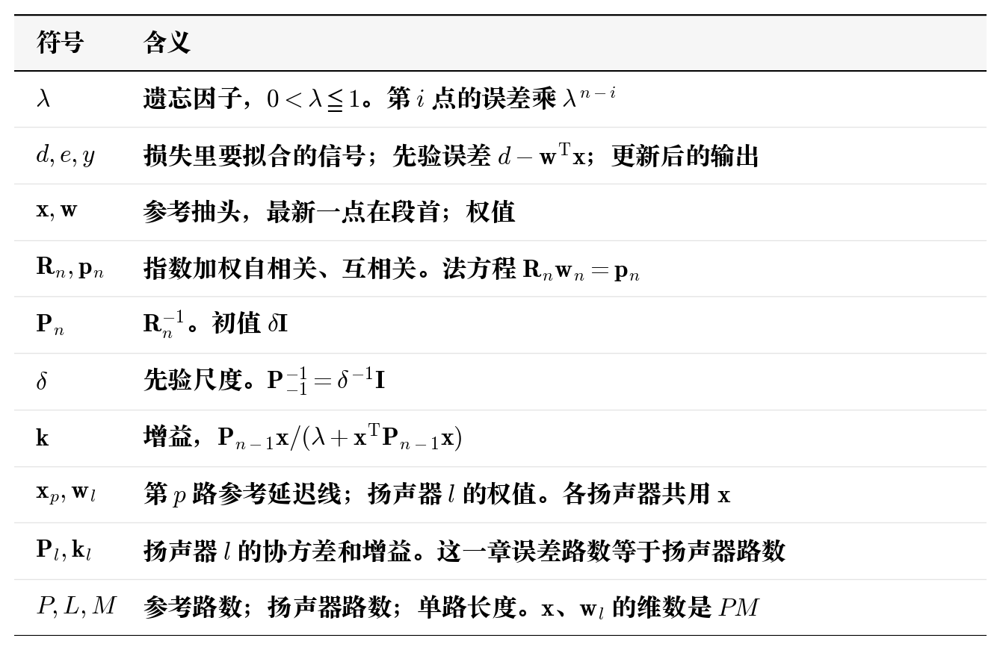
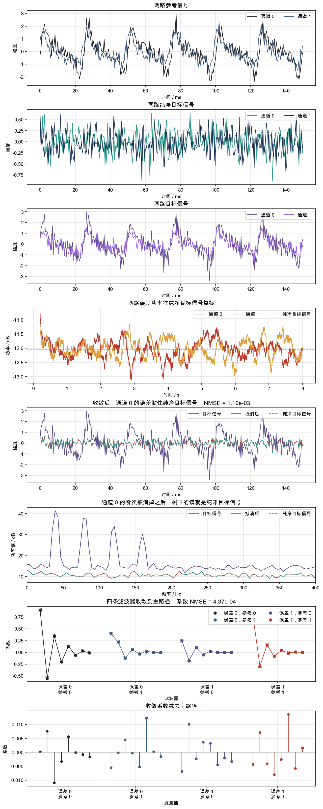
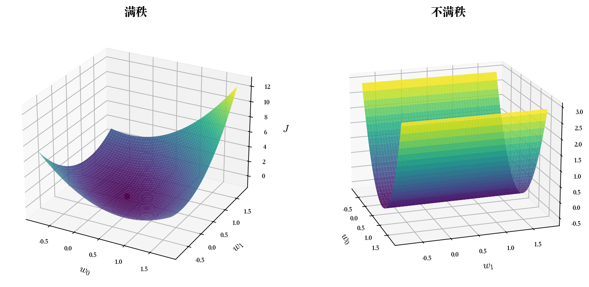

# RLS

LMS 算法降维可以带来算力内存上的便利，但是维纳滤波使用的统计量也会被降为一阶统计量，这会导致收敛速度和收敛误差均劣化，那么自然的会想要保持二阶统计量，最简单的方法当然就是直接使用维纳滤波，但是维纳本身不适合在线，所以产生了 rls 算法。当前文献为 Simon Haykin, *Adaptive Filter Theory*, Prentice Hall。

ps:公式推导只是按照自己的理解进行简化版的推导，也许并不严谨。

## 1. 数学模型

**符号**

在线更新首先要解决的问题就是如何按时间递推求解各个系数。当然可以采用最粗暴的方法，直接每点进来都求解一次维纳滤波，实际上在维纳滤波的仿真当中我就是这样做的，但是这样没有任何实用价值，算力消耗太大了。换种思路，目前的矩阵相关计算本质上是内积求和操作，但实际上我们不需要所有历史点的求和，我们只需要近期求和就可以了，那么我们可以联想到一个非常经典的算法，指数加权平均，我们采用的也就是指数加权求和。

从维纳滤波的均方误差开始推导

$$
J(\mathbf{w})=E\!\left[\bigl(d(n)-\mathbf{w}^{\mathsf T}\mathbf{x}(n)\bigr)^{2}\right]
$$

宽平稳、各态历经时，期望换成一条记录上的时间平均，并且除以样本个数 $K$。$1/K$ 不随 $\mathbf{w}$ 变，求导之后只是梯度上的一个正的常数，令梯度为零的那个 $\mathbf{w}$ 不变，先拿掉。抽头填满之后、每一点等权、同一组 $\mathbf{w}$ 重放整段记录：

$$
J_{N}(\mathbf{w})
=\sum_{i=M-1}^{N-1}\bigl(d(i)-\mathbf{w}^{\mathsf T}\mathbf{x}(i)\bigr)^{2}
$$

在线时记录收到当前点就停，上界改成 $n$。下界放到记录开头 $i=0$，开头抽头不满的那些点用延迟线里已经有的样本。等权换成指数权，第 $i$ 点乘 $\lambda^{n-i}$，$0<\lambda\le 1$，越旧的误差权重越小。$\lambda=1$ 时每一项权重都是 $1$，最小值和上面这条有限记录损失相同。

样本还少、$\mathbf{R}$ 还可能奇异时，加上先验，其实就是近似的正则项。$\mathbf{w}_{-1}=\mathbf{0}$，$\mathbf{P}_{-1}^{-1}=\delta^{-1}\mathbf{I}$。先验和数据一起每一点乘 $\lambda$，写到时刻 $n$ 时前面是 $\lambda^{n+1}$。于是

$$
\begin{aligned}
J_n(\mathbf{w})
&=\sum_{i=0}^{n}\lambda^{n-i}\bigl(d(i)-\mathbf{w}^{\mathsf T}\mathbf{x}(i)\bigr)^{2}\\
&\quad+\lambda^{n+1}(\mathbf{w}-\mathbf{w}_{-1})^{\mathsf T}\mathbf{P}_{-1}^{-1}(\mathbf{w}-\mathbf{w}_{-1})\\
&=\sum_{i=0}^{n}\lambda^{n-i}\bigl(d(i)-\mathbf{w}^{\mathsf T}\mathbf{x}(i)\bigr)^{2}\\
&\quad+\lambda^{n+1}\delta^{-1}\mathbf{w}^{\mathsf T}\mathbf{w}
\end{aligned}
$$

$\delta$ 越小，正则项权重越大，对应的先验对 $\mathbf{w}$ 压制越严重。到了这一步我们返回去，用损失函数再次对 $\mathbf{w}$ 求导并令梯度为零

$$
\mathbf{R}_n\mathbf{w}_n=\mathbf{p}_n
$$

其中

$$
\begin{aligned}
\mathbf{R}_n
&=\lambda^{n+1}\delta^{-1}\mathbf{I}
+\sum_{i=0}^{n}\lambda^{n-i}\mathbf{x}(i)\mathbf{x}^{\mathsf T}(i)\\
\mathbf{p}_n
&=\sum_{i=0}^{n}\lambda^{n-i}\mathbf{x}(i)\,d(i)
\end{aligned}
$$

这其实就是维纳滤波的法方程，只不过$\mathbf{R}_n$、$\mathbf{p}_n$ 采用指数加权求和递推

$$
\mathbf{R}_n=\lambda\mathbf{R}_{n-1}+\mathbf{x}(n)\mathbf{x}^{\mathsf T}(n),\qquad
\mathbf{p}_n=\lambda\mathbf{p}_{n-1}+\mathbf{x}(n)\,d(n)
$$

每一点把 $\mathbf{R}_n$ 求逆仍是 $O(M^3)$，接下来我们直接推导逆矩阵的递推方程。记协方差 $\mathbf{P}_n=\mathbf{R}_n^{-1}$，它是自相关的逆（我这里取名为协方差是有原因的，因为在卡尔曼滤波器模型中等效变量就叫做协方差）。下面用矩阵求逆引理把「对 $\mathbf{R}_n$ 求逆」换成「用上一次迭代的 $\mathbf{P}_{n-1}$ 做一次修正」。

这一点的自相关是旧自相关乘 $\lambda$，再加一个外积

$$
\mathbf{R}_n=\lambda\mathbf{R}_{n-1}+\mathbf{x}(n)\mathbf{x}^{\mathsf T}(n)
$$

矩阵求逆引理：$\mathbf{A}$ 可逆，$\mathbf{u}$ 是同维列向量时

$$
\bigl(\mathbf{A}+\mathbf{u}\mathbf{u}^{\mathsf T}\bigr)^{-1}
=\mathbf{A}^{-1}
-\frac{\mathbf{A}^{-1}\mathbf{u}\,\mathbf{u}^{\mathsf T}\mathbf{A}^{-1}}
{1+\mathbf{u}^{\mathsf T}\mathbf{A}^{-1}\mathbf{u}}
$$

取 $\mathbf{A}=\lambda\mathbf{R}_{n-1}$，$\mathbf{u}=\mathbf{x}(n)$。由 $\mathbf{P}_{n-1}=\mathbf{R}_{n-1}^{-1}$ 得 $\mathbf{A}^{-1}=\lambda^{-1}\mathbf{P}_{n-1}$。代进去

$$
\mathbf{P}_n
=\lambda^{-1}\mathbf{P}_{n-1}
-\frac{\lambda^{-2}\mathbf{P}_{n-1}\mathbf{x}\,\mathbf{x}^{\mathsf T}\mathbf{P}_{n-1}}
{1+\lambda^{-1}\mathbf{x}^{\mathsf T}\mathbf{P}_{n-1}\mathbf{x}}
$$

分母通分，$1+\lambda^{-1}\mathbf{x}^{\mathsf T}\mathbf{P}_{n-1}\mathbf{x}=(\lambda+\mathbf{x}^{\mathsf T}\mathbf{P}_{n-1}\mathbf{x})/\lambda$，分子上的 $\lambda^{-2}$ 和这个 $\lambda$ 合成 $\lambda^{-1}$

$$
\mathbf{P}_n
=\lambda^{-1}\mathbf{P}_{n-1}
-\lambda^{-1}
\frac{\mathbf{P}_{n-1}\mathbf{x}\,\mathbf{x}^{\mathsf T}\mathbf{P}_{n-1}}
{\lambda+\mathbf{x}^{\mathsf T}\mathbf{P}_{n-1}\mathbf{x}}
$$

把增益定义成上一次迭代的协方差作用在当前回归量上，再按这个分母归一

$$
\mathbf{k}(n)
=\frac{\mathbf{P}_{n-1}\mathbf{x}(n)}
{\lambda+\mathbf{x}^{\mathsf T}(n)\mathbf{P}_{n-1}\mathbf{x}(n)}
$$

于是协方差/逆矩阵本身的递推不再出现 $\mathbf{R}_n$

$$
\mathbf{P}_n
=\lambda^{-1}\Bigl(
\mathbf{P}_{n-1}
-\mathbf{k}(n)\,\mathbf{x}^{\mathsf T}(n)\mathbf{P}_{n-1}
\Bigr)
$$

权值同样不必再解 $\mathbf{R}_n\mathbf{w}_n=\mathbf{p}_n$，而是通过递推更新（这里可以留意一下这个更新公式，后续卡尔曼滤波会从另一个建模视角出发得到近似的结论，他们出发点不同但实际上有着强关联）。由 $\mathbf{p}_{n-1}=\mathbf{R}_{n-1}\mathbf{w}_{n-1}$ 和 $\mathbf{p}_n=\lambda\mathbf{p}_{n-1}+\mathbf{x}\,d$

$$
\begin{aligned}
\mathbf{w}_n
&=\mathbf{P}_n\mathbf{p}_n
=\mathbf{P}_n\bigl(\lambda\mathbf{R}_{n-1}\mathbf{w}_{n-1}+\mathbf{x}\,d\bigr)\\
&=\mathbf{P}_n\bigl((\mathbf{R}_n-\mathbf{x}\mathbf{x}^{\mathsf T})\mathbf{w}_{n-1}+\mathbf{x}\,d\bigr)\\
&=\mathbf{w}_{n-1}
+\mathbf{P}_n\mathbf{x}\,\bigl(d-\mathbf{w}_{n-1}^{\mathsf T}\mathbf{x}\bigr)
\end{aligned}
$$

右边的 $\mathbf{P}_n\mathbf{x}$ 就是 $\mathbf{k}(n)$。把上面的 $\mathbf{P}_n$ 乘到 $\mathbf{x}$ 上

$$
\begin{aligned}
\mathbf{P}_n\mathbf{x}
&=\lambda^{-1}\mathbf{P}_{n-1}\mathbf{x}
-\lambda^{-1}
\frac{\mathbf{P}_{n-1}\mathbf{x}\,(\mathbf{x}^{\mathsf T}\mathbf{P}_{n-1}\mathbf{x})}
{\lambda+\mathbf{x}^{\mathsf T}\mathbf{P}_{n-1}\mathbf{x}}\\
&=\lambda^{-1}\mathbf{P}_{n-1}\mathbf{x}
\left(
1-\frac{\mathbf{x}^{\mathsf T}\mathbf{P}_{n-1}\mathbf{x}}
{\lambda+\mathbf{x}^{\mathsf T}\mathbf{P}_{n-1}\mathbf{x}}
\right)\\
&=\frac{\mathbf{P}_{n-1}\mathbf{x}}
{\lambda+\mathbf{x}^{\mathsf T}\mathbf{P}_{n-1}\mathbf{x}}
=\mathbf{k}(n)
\end{aligned}
$$

预测误差用更新前的权值，$e(n)=d(n)-\mathbf{w}_{n-1}^{\mathsf T}\mathbf{x}(n)$。权值更新之后，这一点的输出再用新权值去点参考

$$
\begin{aligned}
\mathbf{w}_n&=\mathbf{w}_{n-1}+\mathbf{k}(n)\,e(n)\\
y(n)&=\mathbf{w}_n^{\mathsf T}\mathbf{x}(n)
\end{aligned}
$$

多通道时每个扬声器一份 $\mathbf{w}$，各量按参考通道拼接，段内再按滞后排列，最新一点在段首。

第 $p$ 路参考的延迟线

$$
\mathbf{x}_p(n)
=\begin{bmatrix}x_p(n)&x_p(n-1)&\cdots&x_p(n-M+1)\end{bmatrix}^{\mathsf T}
$$

$P$ 路按编号 $0,\ldots,P-1$ 首尾相接。没有用到的参考填 $0$。长度 $PM$

$$
\mathbf{x}(n)
=\begin{bmatrix}\mathbf{x}_0(n)\\\vdots\\\mathbf{x}_{P-1}(n)\end{bmatrix}
$$

第 $l$ 个扬声器的权值用同一套下标。第 $p$ 段、段内第 $m$ 个元素是扬声器 $l$ 对第 $p$ 路参考、滞后 $m$ 的系数，和 $\mathbf{x}$ 的第 $p$ 段对齐

$$
\mathbf{w}_l
=\begin{bmatrix}\mathbf{w}_{l0}\\\vdots\\\mathbf{w}_{l,P-1}\end{bmatrix}
$$

扬声器 $l$ 的 $\mathbf{P}_l=\mathbf{R}_l^{-1}$ 是 $PM\times PM$，是该扬声器自相关的逆。第 $(pM+m)$ 行、第 $(rM+k)$ 列是第 $p$ 路滞后 $m$ 与第 $r$ 路滞后 $k$。$\mathbf{P}_l(0)=\delta\mathbf{I}$。

各扬声器共用这一条 $\mathbf{x}$。仿真模拟的场景是直接采集到误差的，而代码中就需要用更新前的 $\mathbf{w}_l$ 计算出误差，更新之后再输出。

$$
\begin{aligned}
e_l&=d_l-\mathbf{w}_l^{\mathsf T}\mathbf{x}\\
\mathbf{k}_l
&=\frac{\mathbf{P}_l\mathbf{x}}{\lambda+\mathbf{x}^{\mathsf T}\mathbf{P}_l\mathbf{x}}\\
\mathbf{w}_l
&\leftarrow\mathbf{w}_l+\mathbf{k}_l\,e_l\\
\mathbf{P}_l
&\leftarrow\lambda^{-1}\bigl(\mathbf{P}_l-\mathbf{k}_l\mathbf{x}^{\mathsf T}\mathbf{P}_l\bigr)\\
y_l&=\mathbf{w}_l^{\mathsf T}\mathbf{x}
\end{aligned}
$$

注意这一节主要是引入 RLS 算法，没有对次级路径建模，所以误差数就是扬声器数。多通道损失函数建模就是线性相加，对应到矩阵运算其实就是矢量的拼接，所以这里的参考信号等等都是直接拼接得到的。

$$
\begin{aligned}
J_n
&=\sum_{l=0}^{L-1}J_{n,l}(\mathbf{w}_l)\\
J_{n,l}(\mathbf{w}_l)
&=\sum_{i=0}^{n}\lambda^{n-i}\bigl(d_l(i)-\mathbf{w}_l^{\mathsf T}\mathbf{x}(i)\bigr)^{2}\\
&\quad+\lambda^{n+1}(\mathbf{w}_l-\mathbf{w}_{l,-1})^{\mathsf T}
\mathbf{P}_{l,-1}^{-1}(\mathbf{w}_l-\mathbf{w}_{l,-1})\\
&=\sum_{i=0}^{n}\lambda^{n-i}\bigl(d_l(i)-\mathbf{w}_l^{\mathsf T}\mathbf{x}(i)\bigr)^{2}\\
&\quad+\lambda^{n+1}\delta^{-1}\mathbf{w}_l^{\mathsf T}\mathbf{w}_l
\end{aligned}
$$

第二行同样把 $\mathbf{w}_{l,-1}=\mathbf{0}$、$\mathbf{P}_{l,-1}^{-1}=\delta^{-1}\mathbf{I}$ 代进去。第 $l$ 项里只有 $\mathbf{w}_l$。对它求导并令梯度为零，得到的就是这一路自己的法方程 $\mathbf{R}_l\mathbf{w}_l=\mathbf{p}_l$。

## 2. 实例

取 $P=2$，$L=2$，$M=1$，$\lambda=1$，$\delta=1$。两路权值初值都是 0，$\mathbf{P}$ 初值都是 $\mathbf{I}$。输入是各路参考和各路采集到的 $d$。用更新前的权值算出先验误差，更新之后再点参考得到输出。

第 0 点参考是 $[1,0]^{\mathsf T}$，采集到的是 $[1,0]^{\mathsf T}$。抽头长度是 1，回归量就是 $\mathbf{x}=[1,0]^{\mathsf T}$。更新前两路权值都是 0，点出来都是 0，所以

$$
e_0=1-0=1,\qquad e_1=0-0=0
$$

$$
\mathbf{P}\mathbf{x}=\begin{bmatrix}1\\0\end{bmatrix},\qquad
\lambda+\mathbf{x}^{\mathsf T}\mathbf{P}\mathbf{x}=2,\qquad
\mathbf{k}=\begin{bmatrix}1/2\\0\end{bmatrix}
$$

第 0 路加上 $\mathbf{k}\,e_0$，第 1 路的 $e_1$ 是 0，权值不动。$\mathbf{P}$ 不看误差，两路相同

$$
\mathbf{w}_0=\begin{bmatrix}1/2\\0\end{bmatrix},\qquad
\mathbf{w}_1=\begin{bmatrix}0\\0\end{bmatrix},\qquad
\mathbf{P}=\begin{bmatrix}1/2&0\\0&1\end{bmatrix}
$$

再用更新后的权值点这一条参考

$$
y_0=\begin{bmatrix}1/2&0\end{bmatrix}\begin{bmatrix}1\\0\end{bmatrix}=\frac{1}{2},\qquad
y_1=0
$$

第 1 点参考是 $[0,1]^{\mathsf T}$，采集到的仍是 $[1,0]^{\mathsf T}$。回归量 $\mathbf{x}=[0,1]^{\mathsf T}$。第 0 路更新前的权值点它仍是 0，先验误差仍是 1；第 1 路仍是 0

$$
\mathbf{P}\mathbf{x}=\begin{bmatrix}0\\1\end{bmatrix},\qquad
\lambda+\mathbf{x}^{\mathsf T}\mathbf{P}\mathbf{x}=2,\qquad
\mathbf{k}=\begin{bmatrix}0\\1/2\end{bmatrix}
$$

$$
\mathbf{w}_0=\begin{bmatrix}1/2\\0\end{bmatrix}+\begin{bmatrix}0\\1/2\end{bmatrix}
=\begin{bmatrix}1/2\\1/2\end{bmatrix},\qquad
\mathbf{w}_1=\begin{bmatrix}0\\0\end{bmatrix}
$$

$$
y_0=\begin{bmatrix}1/2&1/2\end{bmatrix}\begin{bmatrix}0\\1\end{bmatrix}=\frac{1}{2},\qquad
y_1=0
$$

两路参考各改到了第 0 路系数的一个抽头上。第 1 路采集到的是 0，先验误差是 0，所以它的系数和输出都不动。

## 3. 仿真

码仓：https://github.com/liang-nian/anc.git

### 3.1 函数对应的公式

`RlsCreate` 按参考路数 $P$、扬声器路数 $L$、抽头长度 $M$、遗忘因子 $\lambda$ 和初值 $\delta$ 建状态。这里的扬声器就是误差通道，没有次级路径。每一路有一条长度 $PM$ 的权值，各自一份 $PM\times PM$ 的 $\mathbf{P}_l$，初值 $\delta\mathbf{I}$。权值按下标 $(lP+p)M+k$ 排，$k=0$ 是当前抽头。

一个采样点调用一次 `RlsCore`。它里面按顺序是四步：推进参考，用更新前的权值算输出和先验误差，算增益并改权值，再改 $\mathbf{P}$。

先把各路参考推进延迟线，拼成第 1 节的 $\mathbf{x}$

$$
\mathbf{x}
=\begin{bmatrix}\mathbf{x}_0\\\vdots\\\mathbf{x}_{P-1}\end{bmatrix},\qquad
\mathbf{x}_p
=\begin{bmatrix}x_p(n)&\cdots&x_p(n-M+1)\end{bmatrix}^{\mathsf T}
$$

各路误差通道各自用更新前的 $\mathbf{w}_l$ 点 $\mathbf{x}$，得到返回的 $y_l$，再和目标做先验误差

$$
y_l=\mathbf{w}_l^{\mathsf T}\mathbf{x},\qquad
e_l=d_l-y_l
$$

这一步返回的就是更新前的点积。第 1 节公式里更新后再点一次的 $y_l=\mathbf{w}_l^{\mathsf T}\mathbf{x}$ 不另返回。

增益和权值按第 1 节

$$
\mathbf{k}_l
=\frac{\mathbf{P}_l\mathbf{x}}{\lambda+\mathbf{x}^{\mathsf T}\mathbf{P}_l\mathbf{x}},\qquad
\mathbf{w}_l
\leftarrow\mathbf{w}_l+\mathbf{k}_l\,e_l
$$

代码里先算 $\mathbf{P}_l\mathbf{x}$，再除分母得到 $\mathbf{k}_l$，立刻加到 $\mathbf{w}_l$ 上。

协方差按同一节

$$
\mathbf{P}_l
\leftarrow\lambda^{-1}\bigl(\mathbf{P}_l-\mathbf{k}_l\mathbf{x}^{\mathsf T}\mathbf{P}_l\bigr)
$$

实现写成 $\lambda^{-1}\bigl(\mathbf{P}_l-(\mathbf{P}_l\mathbf{x})(\mathbf{P}_l\mathbf{x})^{\mathsf T}/(\lambda+\mathbf{x}^{\mathsf T}\mathbf{P}_l\mathbf{x})\bigr)$，和上面同一式。各路 $\mathbf{w}_l$、$\mathbf{P}_l$ 互不串。

`RlsCopyWeights` 抄出的排列是误差、参考、抽头，抽头下标 0 是当前点。

### 3.2 仿真设计

采样率 $f_s=2000\,\mathrm{Hz}$，$N_{\mathrm{sim}}=16000$，随机数种子为 7。$P=2$，$L=2$，$M=8$。$\lambda=1$，$\delta=1$。

两路参考都是 40、80、120、160 Hz 四个阶次。通道 0 的幅度是 1、0.7、0.45、0.25，通道 1 是 0.75、0.55、0.30、0.20，相位错开 0.6。每路再加标准差 0.35 的白噪声。纯净目标信号两路独立，标准差都是 0.25。

没有次级路径。主路径就是要收敛到的系数，四条 FIR 为

$$
\begin{aligned}
\mathbf{b}_{00}&=\begin{bmatrix}0.9&-0.55&0.35&-0.2&0.12&-0.06&0.03&-0.01\end{bmatrix}^{\mathsf T}\\
\mathbf{b}_{01}&=\begin{bmatrix}0.4&0.22&-0.12&0.06&-0.03&0.01&0&0\end{bmatrix}^{\mathsf T}\\
\mathbf{b}_{10}&=\begin{bmatrix}0.25&-0.18&0.10&-0.05&0.02&0&0&0\end{bmatrix}^{\mathsf T}\\
\mathbf{b}_{11}&=\begin{bmatrix}0.8&-0.30&0.16&-0.08&0.04&-0.02&0.01&0\end{bmatrix}^{\mathsf T}
\end{aligned}
$$

目标信号是参考经过对应的主路径再相加，加上纯净目标信号。

### 3.3 仿真结果

波形取记录末尾 $150\,\mathrm{ms}$。功率曲线是整段 $8\,\mathrm{s}$ 上、$0.2\,\mathrm{s}$ 滑动平均后的误差功率。功率谱取末尾 $4\,\mathrm{s}$。误差 NMSE 用末尾 $2\,\mathrm{s}$。系数取整段跑完之后的值，和主路径比较。

**「两路参考信号」**：黑线是通道 0，大约在 $-2.4$ 到 $3$；蓝线是通道 1，大约在 $-1.7$ 到 $2.4$。阶次的起伏还在，上面叠着各自的白噪声。

**「两路纯净目标信号」**：两路都是标准差 0.25 的白噪声，这一段大约在 $-0.9$ 到 $0.7$。

**「两路目标信号」**：通道 0 大约在 $-3.4$ 到 $3$，通道 1 大约在 $-1.8$ 到 $1.7$。里面是两路参考经各自主路径之后的成分，再加纯净目标信号。

**「两路误差功率往纯净目标信号靠拢」**：红线和黄线很快贴上大约 $-12.1\,\mathrm{dB}$ 的青绿虚线，之后在虚线附近抖动。虚线是两路纯净目标信号的平均功率。

**「收敛后，通道 0 的误差贴住纯净目标信号」**：紫线仍是通道 0 的目标信号。红线是抵消后，青绿虚线是纯净目标信号，两条叠在大约 $-0.9$ 到 $0.7$。末尾 $2\,\mathrm{s}$ 里，通道 0 相对纯净目标信号的 NMSE 是 $1.20\times 10^{-3}$，通道 1 是 $1.59\times 10^{-3}$。

**「通道 0 的阶次被消掉之后，剩下的谱就是纯净目标信号」**：紫线在 40、80、120、160 Hz 有四个峰。红线和青绿虚线贴在一条平线上，四个峰消失。

**「四条滤波器收敛到主路径」**：圆点是主路径，叉号是估计。四条 FIR 都落到圆点上，系数 NMSE 是 $4.37\times 10^{-4}$。

**「收敛系数减去主路径」**：各抽头的差都在 $\pm 0.01$ 以内。

## 4. 补充

之前推导维纳解特性的时候提到过从方程组角度可以很容易的理解其特性约束，但实际上还是从矩阵进行推导的，这里换到方程组视角举例解释。

维纳霍普方程其实就是一个方程组，我们将其展开成最简单的二维。$\mathbf{R}$ 的元素写成 $r_{00}$、$r_{01}$ 这种，$\mathbf{w}$ 是 $w_0$、$w_1$，$\mathbf{p}$ 是 $p_0$、$p_1$

$$
\begin{bmatrix}
r_{00}&r_{01}\\
r_{10}&r_{11}
\end{bmatrix}
\begin{bmatrix}w_0\\w_1\end{bmatrix}=
\begin{bmatrix}p_0\\p_1\end{bmatrix}
$$

$$
\begin{cases}
r_{00}w_0+r_{01}w_1=p_0\\
r_{10}w_0+r_{11}w_1=p_1
\end{cases}
$$

注意这个自相关矩阵是满秩的，这样就很清晰了，我们都知道方程组是否有唯一有效解完全取决于变量系数。我们在分析维纳霍普解的时候提到过如果自相关矩阵病态问题就无法找到最优解，我们可以看一下原因，最简单的病态就是不满秩，也就是系数变量存在一行为0

$$
\begin{bmatrix}
r_{00}&0\\
0&0
\end{bmatrix}
\begin{bmatrix}w_0\\w_1\end{bmatrix}=
\begin{bmatrix}p_0\\0\end{bmatrix}
$$

$$
\begin{cases}
r_{00}w_0=p_0\\
0=0
\end{cases}
$$

第二行系数都是 0。对称性把 $r_{01}$、$r_{11}$ 也收成 0，要有解的话 $p_1$ 也是 0。$w_0=p_0/r_{00}$，$w_1$ 可以随便取任意解，所谓的任意解其实就是找不到唯一解，对应到最优化建模，本质上就是无解，我们可以画图看一下问题曲面。曲面用

$$
J=\mathbf{w}^{\mathsf T}\mathbf{R}\mathbf{w}-2\mathbf{p}^{\mathsf T}\mathbf{w}
$$

梯度是 $2(\mathbf{R}\mathbf{w}-\mathbf{p})$，它等于 0 就是上面的方程组。满秩取 $r_{00}=2$，$r_{01}=r_{10}=1$，$r_{11}=2$，$p_0=p_1=1$，唯一解是 $w_0=w_1=1/3$。不满秩取 $r_{00}=2$，其余相关都是 0，$p_0=1$，$p_1=0$，于是 $w_0=1/2$，$w_1$ 任意。

**「满秩」**：碗只有一个底，红点是梯度为 0 的那一个解。

**「不满秩」**：沿 $w_1$ 是一条槽，槽底在 $w_0=1/2$。槽上每一点梯度都是 0，最优解锁不住。

这意味着什么？如果矩阵病态，那么理论上某些滤波器系数可以无限漂移得到无穷大值都不会产生任何有意义的解。所以自相关矩阵决定了是否有解，那么互相关呢？互相关决定解的具体值，只要自相关不是病态，无论互相关取什么值，方程都将有解，但是如果互相关算的都是些无关噪声的信息，那么自适应滤波器收敛结果将会失去意义。