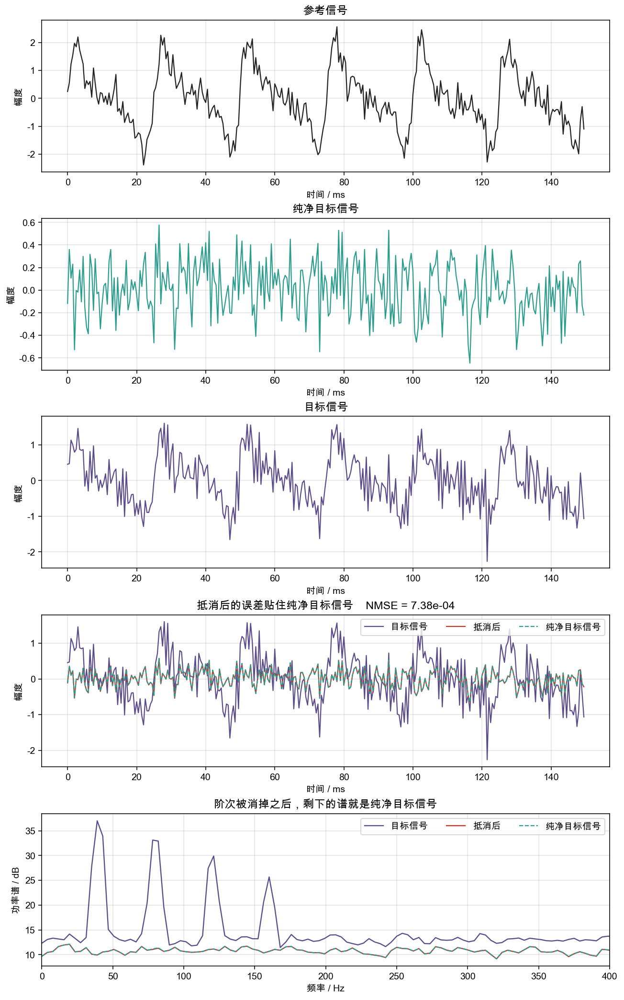

# 维纳滤波

主动降噪在降噪耳机上已经是成熟技术，近来更是在车载上重新受到重视。主流的前馈降噪学习的是参考点到降噪目标点的线性传递路径，也就是一条 FIR 滤波器。用参考信号经过FIR滤波器映射得到目标点的噪声，扬声器播放反相声波，把目标点的噪声声压抵消掉。这条 FIR 在均方误差意义下的最优系数，就是维纳解。

ps:公式推导只是按照自己的理解进行简化版的推导，也许并不严谨。

## 1. 数学模型

$x(n)$ 是参考点信号，$d(n)$ 是目标点的主噪声。允许使用当前点和过去 $M-1$ 点滤波计算目标点处的参考噪声成分：

$$
\hat{d}(n)=\sum_{k=0}^{M-1} w_k\, x(n-k)=\mathbf{w}^{\mathsf T}\mathbf{x}(n)
$$

$$
\mathbf{w}=\begin{bmatrix}w_0&w_1&\cdots&w_{M-1}\end{bmatrix}^{\mathsf T},\qquad
\mathbf{x}(n)=\begin{bmatrix}x(n)&x(n-1)&\cdots&x(n-M+1)\end{bmatrix}^{\mathsf T}
$$

预测误差

$$
e(n)=d(n)-\hat{d}(n)
$$

损失函数选用均方误差：

$$
J(\mathbf{w})=E\!\left[e^2(n)\right]=E\!\left[\bigl(d(n)-\mathbf{w}^{\mathsf T}\mathbf{x}(n)\bigr)^2\right]
$$

根据期望的计算公式进行平方展开：

$$
\begin{aligned}
J(\mathbf{w})
&=E[d^2(n)]-2\mathbf{w}^{\mathsf T}E[\mathbf{x}(n)d(n)]+\mathbf{w}^{\mathsf T}E[\mathbf{x}(n)\mathbf{x}^{\mathsf T}(n)]\mathbf{w}\\
&=\sigma_d^2-2\mathbf{w}^{\mathsf T}\mathbf{p}+\mathbf{w}^{\mathsf T}\mathbf{R}\mathbf{w}
\end{aligned}
$$

其中

$$
\sigma_d^2=E[d^2(n)]
$$

$$
\mathbf{R}=E[\mathbf{x}(n)\mathbf{x}^{\mathsf T}(n)],\qquad
R_{ij}=r_{xx}(i-j)=E[x(n-i)x(n-j)]
$$

$$
\mathbf{p}=E[\mathbf{x}(n)d(n)],\qquad
p_i=r_{dx}(i)=E[d(n)x(n-i)]
$$

$\mathbf{R}$ 是对称的 Toeplitz 矩阵。只要参考信号的各抽头不是线性相关的，$\mathbf{R}$ 就是正定的，二次型有唯一最小值。

已知两条矩阵求导公式：

$$
\frac{\partial}{\partial\mathbf{w}}(\mathbf{w}^{\mathsf T}\mathbf{a})=\mathbf{a}
$$

$$
\frac{\partial}{\partial\mathbf{w}}(\mathbf{w}^{\mathsf T}\mathbf{A}\mathbf{w})=(\mathbf{A}+\mathbf{A}^{\mathsf T})\mathbf{w}
$$

$\mathbf{A}$ 对称时，第二条右边就是 $2\mathbf{A}\mathbf{w}$。$\sigma_d^2$ 与 $\mathbf{w}$ 无关，导数为零；$\mathbf{R}$ 对称。于是

$$
\begin{aligned}
\frac{\partial J}{\partial\mathbf{w}}
&=-2\frac{\partial}{\partial\mathbf{w}}(\mathbf{w}^{\mathsf T}\mathbf{p})+\frac{\partial}{\partial\mathbf{w}}(\mathbf{w}^{\mathsf T}\mathbf{R}\mathbf{w})\\
&=-2\mathbf{p}+2\mathbf{R}\mathbf{w}
\end{aligned}
$$

令梯度为零，得到 Wiener–Hopf 方程

$$
\mathbf{R}\mathbf{w}_\star=\mathbf{p}\qquad\text{即}\qquad\mathbf{w}_\star=\mathbf{R}^{-1}\mathbf{p}
$$

把 $\mathbf{w}_\star$ 代回代价。由 $\mathbf{R}\mathbf{w}_\star=\mathbf{p}$ 得 $\mathbf{w}_\star^{\mathsf T}\mathbf{R}\mathbf{w}_\star=\mathbf{w}_\star^{\mathsf T}\mathbf{p}$，所以

$$
\begin{aligned}
J_{\min}
&=J(\mathbf{w}_\star)\\
&=\sigma_d^2-2\mathbf{w}_\star^{\mathsf T}\mathbf{p}+\mathbf{w}_\star^{\mathsf T}\mathbf{R}\mathbf{w}_\star\\
&=\sigma_d^2-\mathbf{w}_\star^{\mathsf T}\mathbf{p}\\
&=\sigma_d^2-\mathbf{p}^{\mathsf T}\mathbf{R}^{-1}\mathbf{p}
\end{aligned}
$$

到这里为止，式子里用的都是统计量，我们需要把他转换到信号序列值的计算上面来。$E[x(n)]$ 是时刻 $n$ 在全体可能实现上的集合平均，其计算需要把同一时刻的许多条独立观测样本拿来求均值。我们不是奇异博士，没办法观测无穷多条平行时间线，我们在这个时间点上只能做一次样本观测，凑不齐这个平均。

但是信号若是宽平稳的各态历经信号，这个期望就不随 $n$ 改变。就可以基于均值遍历定理把集合平均换成这一条记录上的时间平均：

$$
E[x]=\lim_{N\to\infty}\frac{1}{N}\sum_{n=0}^{N-1}x(n)
$$

$\mathbf{R}$ 和 $\mathbf{p}$ 里要平均的是乘积 $d^2(n)$、$x(n)x(n-k)$ 和 $d(n)x(n-k)$。相关遍历是把均值遍历用到这些乘积过程上：

$$
\begin{aligned}
\sigma_d^2
&=\lim_{N\to\infty}\frac{1}{N}\sum_{n=0}^{N-1}d^2(n)\\
r_{xx}(k)
&=\lim_{N\to\infty}\frac{1}{N}\sum_{n=k}^{N-1}x(n)x(n-k)\\
r_{dx}(k)
&=\lim_{N\to\infty}\frac{1}{N}\sum_{n=k}^{N-1}d(n)x(n-k)
\end{aligned}
$$

求和从 $n=k$ 开始，是为了 $x(n-k)$ 仍落在这条记录里。$N\to\infty$ 时少掉的 $k$ 个点不影响前面的 $1/N$。因此

$$
R_{ij}=r_{xx}(i-j),\qquad p_i=r_{dx}(i)
$$

都变成同一条序列上算得出来的量。记录有限时，把极限换成有限平均，统计公式就落到时域序列上。参与平均的时刻从 $n=M-1$ 到 $n=N-1$，每一行都用满 $M$ 个已经存在的样本，不把序列开头补零混进去。样本个数

$$
L=N-M+1
$$

把这些时刻的期望信号和参考向量叠成矩阵：

$$
\mathbf{d}=\begin{bmatrix}d(M-1)\\ d(M)\\ \vdots\\ d(N-1)\end{bmatrix},\qquad
\mathbf{X}=\begin{bmatrix}
\mathbf{x}^{\mathsf T}(M-1)\\
\mathbf{x}^{\mathsf T}(M)\\
\vdots\\
\mathbf{x}^{\mathsf T}(N-1)
\end{bmatrix}
$$

$\mathbf{X}$ 是 $L\times M$，$\mathbf{d}$ 是 $L\times 1$。有限长度代价就是

$$
J_N(\mathbf{w})=\frac{1}{L}\|\mathbf{d}-\mathbf{X}\mathbf{w}\|^2
=\frac{1}{L}(\mathbf{d}-\mathbf{X}\mathbf{w})^{\mathsf T}(\mathbf{d}-\mathbf{X}\mathbf{w})
$$

展开后和上面的统计二次型相同，只是期望换成了样本平均：

$$
J_N(\mathbf{w})=\widehat{\sigma}_d^2-2\mathbf{w}^{\mathsf T}\hat{\mathbf{p}}+\mathbf{w}^{\mathsf T}\hat{\mathbf{R}}\mathbf{w}
$$

$$
\hat{\mathbf{R}}=\frac{1}{L}\mathbf{X}^{\mathsf T}\mathbf{X},\qquad
\hat{\mathbf{p}}=\frac{1}{L}\mathbf{X}^{\mathsf T}\mathbf{d},\qquad
\widehat{\sigma}_d^2=\frac{1}{L}\mathbf{d}^{\mathsf T}\mathbf{d}
$$

对 $\mathbf{w}$ 求导并令梯度为零，仍是 Wiener–Hopf 方程

$$
\hat{\mathbf{R}}\mathbf{w}_\star=\hat{\mathbf{p}}\qquad\text{即}\qquad\mathbf{w}_\star=\hat{\mathbf{R}}^{-1}\hat{\mathbf{p}}
$$

代回代价，

$$
J_{\min}=\widehat{\sigma}_d^2-\hat{\mathbf{p}}^{\mathsf T}\hat{\mathbf{R}}^{-1}\hat{\mathbf{p}}
$$

## 2. 实例

假设二阶滤波器为

$$
\hat{d}(n)=w_0 x(n)+w_1 x(n-1)
$$

现在已知参考序列和目标序列的4点时间序列为

$$
\begin{aligned}
x(n)&: 1,\;1,\;1,\;-1\\
d(n)&: 0,\;1,\;0,\;0
\end{aligned}
\qquad n=0,1,2,3
$$

取 $L=3$ 点进行相关计算，此处不进行补0，而是直接满抽头从 $n=1$ 开始，到 $n=3$ 结束。已知滤波器阶数为 $M=2$，可以确定自相关矩阵计算纬度，得到

$$
\begin{aligned}
E[x^2(n)]
&=\frac{x(1)^2+x(2)^2+x(3)^2}{3}
=\frac{1^2+1^2+(-1)^2}{3}
=\frac{1+1+1}{3}=1\\
E[x^2(n-1)]
&=\frac{1+1+1}{3}=1\\
E[x(n)x(n-1)]
&=\frac{1+1+(-1)}{3}=\frac{1}{3}\\
E[d(n)x(n)]
&=\frac{d(1)x(1)+d(2)x(2)+d(3)x(3)}{3}
=\frac{1\cdot 1+0\cdot 1+0\cdot(-1)}{3}
=\frac{1}{3}\\
E[d(n)x(n-1)]
&=\frac{1+0+0}{3}=\frac{1}{3}\\
\sigma_d^2
&=\frac{d(1)^2+d(2)^2+d(3)^2}{3}
=\frac{1^2+0^2+0^2}{3}
=\frac{1}{3}
\end{aligned}
$$

于是

$$
\mathbf{R}=\begin{bmatrix}1&1/3\\1/3&1\end{bmatrix},\qquad
\mathbf{p}=\begin{bmatrix}1/3\\1/3\end{bmatrix}
$$

用上面得到的 Wiener–Hopf 方程 $\mathbf{w}_\star=\mathbf{R}^{-1}\mathbf{p}$。先求逆，$\det\mathbf{R}=8/9$，

$$
\mathbf{R}^{-1}=\frac{9}{8}\begin{bmatrix}1&-1/3\\-1/3&1\end{bmatrix}
=\begin{bmatrix}9/8&-3/8\\-3/8&9/8\end{bmatrix}
$$

$$
\mathbf{w}_\star=\mathbf{R}^{-1}\mathbf{p}
=\begin{bmatrix}9/8&-3/8\\-3/8&9/8\end{bmatrix}
\begin{bmatrix}1/3\\1/3\end{bmatrix}
=\begin{bmatrix}1/4\\1/4\end{bmatrix}
$$

最小均方误差用代回后的式子：

$$
\begin{aligned}
J_{\min}
&=\sigma_d^2-\mathbf{p}^{\mathsf T}\mathbf{R}^{-1}\mathbf{p}\\
&=\frac{1}{3}-\begin{bmatrix}1/3&1/3\end{bmatrix}\begin{bmatrix}1/4\\1/4\end{bmatrix}\\
&=\frac{1}{3}-\frac{1}{6}=\frac{1}{6}
\end{aligned}
$$

## 3. 仿真

码仓：https://github.com/liang-nian/anc.git

### 3.1 函数对应的公式

`WienerFirDesign` 求解基于信号序列的 Wiener–Hopf 方程

$$
\hat{R}_{ij}=\frac{1}{L}\sum_{t=M-1}^{N-1}x(t-i)x(t-j),\qquad
\hat{p}_i=\frac{1}{L}\sum_{t=M-1}^{N-1}d(t)\,x(t-i)
$$

其中 $L=N-M+1$，求和起点 `start = M - 1`。

$$
\hat{\mathbf{R}}=\frac{1}{L}\mathbf{X}^{\mathsf T}\mathbf{X},\qquad
\hat{\mathbf{p}}=\frac{1}{L}\mathbf{X}^{\mathsf T}\mathbf{d}
$$

$\hat{\mathbf{R}}$ 对称，只算下三角再抄到上三角。

`CholeskySolve` 解 $\hat{\mathbf{R}}\mathbf{w}_\star=\hat{\mathbf{p}}$，不显式做 $\hat{\mathbf{R}}^{-1}$。对 $\hat{\mathbf{R}}$ 三角分解得到 $\mathbf{L}\mathbf{L}^{\mathsf T}$，先前代 $\mathbf{L}\mathbf{y}=\hat{\mathbf{p}}$，再回代 $\mathbf{L}^{\mathsf T}\mathbf{w}=\mathbf{y}$。

`WienerFirApply` 执行滤波：

$$
\hat{d}(n)=\mathbf{w}^{\mathsf T}\mathbf{x}(n)=\sum_{k=0}^{M-1}w_k\, x(n-k)
$$

### 3.2 仿真设计

采样率 $f_s=2000\,\mathrm{Hz}$，$N=16000$，随机数种子为 7，阶数 $M=12$。

参考信号是四根阶次加一段白噪声，白噪声标准差 0.35：

$$
\begin{aligned}
s(n)=&\sin(2\pi\cdot 40\, n/f_s)+0.7\sin(2\pi\cdot 80\, n/f_s)\\
&+0.45\sin(2\pi\cdot 120\, n/f_s)+0.25\sin(2\pi\cdot 160\, n/f_s)\\
x(n)=&s(n)+0.35\,g(n)
\end{aligned}
$$

$g(n)$ 是单位方差高斯白噪声。

主路径是预先写好的 12 点 FIR：

$$
\mathbf{h}=[0.90,\,-0.55,\,0.35,\,-0.20,\,0.12,\,-0.08,\,0.05,\,-0.03,\,0.02,\,-0.01,\,0.005,\,-0.002]^{\mathsf T}
$$

滤波器输出送到目标点，播放的是预测的反相。纯净目标信号 $u(n)$ 是目标点上没有从参考传播过来的成分，标准差 0.25，与参考信号无关：

$$
d(n)=\mathbf{h}(n)*x(n)+u(n)
$$

理论上抵消后

$$
e(n)=d(n)-\hat{d}(n)=u(n)
$$

### 3.3 仿真结果

**「参考信号」**：黑线是 $x=s+0.35\,g$，幅度大约在 $\pm 2$。阶次的慢起伏还在，上面叠着白噪声。

**「纯净目标信号」**：青绿线是 $u$，目标点处的原始噪声，不包含参考信号传播过来的成分。它是一段标准差 0.25 的白噪声，幅度大约在 $\pm 0.6$。

**「目标信号」**：紫线是 $d=\mathbf{h}(n)*x(n)+u$。包含参考信号传播过来的成分，幅度大约到 $\pm 1.5$。

**「抵消后的误差贴住纯净目标信号」**：紫线仍是目标信号 $d$。红线是 $e=d-\hat{d}$，青绿虚线是 $u$，两条叠在大约 $\pm 0.6$ 里。按 $e$ 相对 $u$ 来算的 NMSE 是 $7.38\times 10^{-4}$。

**「阶次被消掉之后，剩下的谱就是纯净目标信号」**：紫线在 40、80、120、160 Hz 有四个峰，最高约 37 dB，峰之间的宽带底大约 13 dB，里面有参考白噪声经主路径之后的分量。红线和青绿虚线贴在约 11 dB 的一条平线上，四个峰消失。这条约 11 dB 的平线就是 $u$ 的谱。

## 4. 补充

### 4.1 谐波信号仿真踩坑

实际仿真中几乎下意识的会默认采用部分谐波来合成仿真信号，当采样率极高时，信号值趋同，甚至谐波的值趋于0，会直接导致矩阵逆病态，所以上面的仿真会像波束成形仿真一样，主动添加一些白噪声。

### 4.2 特征值与条件数影响

维纳滤波非常重要的一个特性就是特征值和条件数对结果的稳定性影响。这点在资料里面也经常提到，但比较抽象，因为资料里给出的已经是矩阵视角下的总结。回到 Wiener–Hopf 方程，把它当成一组线性方程来解，特征值和条件数为什么会造成这种影响就很清楚了。

方程是

$$
\mathbf{R}\mathbf{w}=\mathbf{p}
$$

$\mathbf{R}$ 对称正定。每个特征值 $\lambda_i>0$ 对应一个特征向量 $\mathbf{q}_i$，满足

$$
\mathbf{R}\mathbf{q}_i=\lambda_i\mathbf{q}_i
$$

已知$\mathbf{R}$ 对称正定，将特征向量缩放为单位向量后，根据特征向量的性质可知：沿着 $\mathbf{q}_i$，$\mathbf{R}$ 只把向量乘上 $\lambda_i$，不转向； $i=j$ 时 $\mathbf{q}_i^{\mathsf T}\mathbf{q}_j=1$，否则为 0。按列排成

$$
\mathbf{Q}=\begin{bmatrix}\mathbf{q}_1&\mathbf{q}_2&\cdots\end{bmatrix}
$$

就有 $\mathbf{Q}^{\mathsf T}\mathbf{Q}=\mathbf{I}$，所以 $\mathbf{Q}^{-1}=\mathbf{Q}^{\mathsf T}$。$\mathbf{R}\mathbf{q}_i=\lambda_i\mathbf{q}_i$ 合成矩阵是 $\mathbf{R}\mathbf{Q}=\mathbf{Q}\boldsymbol{\Lambda}$，$\boldsymbol{\Lambda}$ 的对角元素是 $\lambda_i$。右乘 $\mathbf{Q}^{\mathsf T}$：

$$
\mathbf{R}=\mathbf{R}\mathbf{Q}\mathbf{Q}^{\mathsf T}=\mathbf{Q}\boldsymbol{\Lambda}\mathbf{Q}^{\mathsf T}
$$

代回原方程：

$$
\mathbf{Q}\boldsymbol{\Lambda}\mathbf{Q}^{\mathsf T}\mathbf{w}=\mathbf{p}
$$

左乘 $\mathbf{Q}^{\mathsf T}$，并用 $\mathbf{Q}^{\mathsf T}\mathbf{Q}=\mathbf{I}$：

$$
\boldsymbol{\Lambda}\mathbf{Q}^{\mathsf T}\mathbf{w}=\mathbf{Q}^{\mathsf T}\mathbf{p}
$$

记

$$
\hat{\mathbf{w}}=\mathbf{Q}^{\mathsf T}\mathbf{w},\qquad
\hat{\mathbf{p}}=\mathbf{Q}^{\mathsf T}\mathbf{p}
$$

$\hat{w}_i=\mathbf{q}_i^{\mathsf T}\mathbf{w}$，根据线代基础，这里实际上是将 $\mathbf{w}$ 线性投影到特征向量构成的坐标系。线性投影可以保留绝大多数基础特性，接下来就在这个投影空间内做分析。$\boldsymbol{\Lambda}$ 是对角阵，第 $i$ 行只剩一项：

$$
\lambda_i\hat{w}_i=\hat{p}_i\qquad\text{即}\qquad\hat{w}_i=\frac{\hat{p}_i}{\lambda_i}
$$

从这里可以得出一个基础结论，假设 $\hat{p}_i$ 为输入，系统特性也就是特征值为已知常量，那么特征值越小，系统输入误差引起的系数解误差就越大，由于两个空间之间是线性变换，满足等比关系，所以这个结论在原空间也是适用的。

条件数是这最大特征值与最小特征值之比

$$
\kappa(\mathbf{R})=\frac{\lambda_{\max}}{\lambda_{\min}}
$$

只扰动右端时，原方程和扰动后的方程是

$$
\mathbf{R}\mathbf{w}=\mathbf{p},\qquad
\mathbf{R}(\mathbf{w}+\delta\mathbf{w})=\mathbf{p}+\delta\mathbf{p}
$$

两式相减得到 $\mathbf{R}\,\delta\mathbf{w}=\delta\mathbf{p}$，所以

$$
\delta\mathbf{w}=\mathbf{R}^{-1}\delta\mathbf{p}
$$

假设存在向量 $\mathbf{v}$ ，投影到特征向量坐标 $\hat{\mathbf{v}}=\mathbf{Q}^{\mathsf T}\mathbf{v}$。$\mathbf{Q}$ 正交，长度不变，$\|\hat{\mathbf{v}}\|=\|\mathbf{v}\|$，并且 $\|\mathbf{R}\mathbf{v}\|=\|\boldsymbol{\Lambda}\hat{\mathbf{v}}\|$。对角阵逐项相乘：

$$
\|\boldsymbol{\Lambda}\hat{\mathbf{v}}\|^2
=\sum_i(\lambda_i\hat{v}_i)^2
\le\lambda_{\max}^2\sum_i\hat{v}_i^2
=\lambda_{\max}^2\|\mathbf{v}\|^2
$$

所以 $\|\mathbf{R}\mathbf{v}\|\le\lambda_{\max}\|\mathbf{v}\|$。$\mathbf{R}^{-1}$ 的特征值是 $1/\lambda_i$，最大的一个是 $1/\lambda_{\min}$，同理得到

$$
\|\mathbf{R}^{-1}\mathbf{v}\|\le\frac{1}{\lambda_{\min}}\|\mathbf{v}\|
$$

用到 $\delta\mathbf{w}$ 和 $\mathbf{p}$ 上：

$$
\|\delta\mathbf{w}\|
=\|\mathbf{R}^{-1}\delta\mathbf{p}\|
\le\frac{\|\delta\mathbf{p}\|}{\lambda_{\min}}
$$

$$
\|\mathbf{p}\|
=\|\mathbf{R}\mathbf{w}\|
\le\lambda_{\max}\|\mathbf{w}\|
$$

第二条两边都是正数，直接取倒数得到：

$$
\frac{1}{\lambda_{\max}\|\mathbf{w}\|}\le\frac{1}{\|\mathbf{p}\|}
$$

再两边同乘正数 $\lambda_{\max}$：

$$
\frac{1}{\|\mathbf{w}\|}\le\frac{\lambda_{\max}}{\|\mathbf{p}\|}
$$

由此得到原始空间内的相对误差：

$$
\begin{aligned}
\frac{\|\delta\mathbf{w}\|}{\|\mathbf{w}\|}
&\le\frac{\|\delta\mathbf{p}\|}{\lambda_{\min}\|\mathbf{w}\|}\\
&\le\frac{\|\delta\mathbf{p}\|}{\lambda_{\min}}\cdot\frac{\lambda_{\max}}{\|\mathbf{p}\|}\\
&=\kappa(\mathbf{R})\frac{\|\delta\mathbf{p}\|}{\|\mathbf{p}\|}
\end{aligned}
$$

可见，误差的相对大小强相关与条件数。

以一个极端的二元方程组为例。条件数极大，两条方程的系数只差 $\frac{1}{1000}$：

$$
\begin{aligned}
\left(10000+\frac{1}{2000}\right)w_0+\left(10000-\frac{1}{2000}\right)w_1&=20000\\
\left(10000-\frac{1}{2000}\right)w_0+\left(10000+\frac{1}{2000}\right)w_1&=20000
\end{aligned}
$$

写成矩阵就是

$$
\mathbf{R}=\begin{bmatrix}10000+\frac{1}{2000}&10000-\frac{1}{2000}\\10000-\frac{1}{2000}&10000+\frac{1}{2000}\end{bmatrix},\qquad
\mathbf{p}=\begin{bmatrix}20000\\20000\end{bmatrix},\qquad
\mathbf{w}=\begin{bmatrix}1\\1\end{bmatrix}
$$

求解特征值得到

$$
\begin{aligned}
\mathbf{R}\begin{bmatrix}1\\1\end{bmatrix}
&=20000\begin{bmatrix}1\\1\end{bmatrix}\\
\mathbf{R}\begin{bmatrix}1\\-1\end{bmatrix}
&=\frac{1}{1000}\begin{bmatrix}1\\-1\end{bmatrix}
\end{aligned}
$$

$\lambda_{\max}=20000$，$\lambda_{\min}=1/1000$，$\kappa(\mathbf{R})=20000/(1/1000)=2\times 10^{7}$。

现假设右端输入引入误差 $\delta\mathbf{p}=[1,\,-1]^{\mathsf T}$，右端变为 $20001$ 和 $19999$。2-范数下 $\|\mathbf{p}\|=20000\sqrt{2}$，$\|\delta\mathbf{p}\|=\sqrt{2}$，相对偏差是 $1/20000$，也就是 $0.005\%$。新方程组是

$$
\begin{aligned}
\left(10000+\frac{1}{2000}\right)w_0+\left(10000-\frac{1}{2000}\right)w_1&=20001\\
\left(10000-\frac{1}{2000}\right)w_0+\left(10000+\frac{1}{2000}\right)w_1&=19999
\end{aligned}
$$

两式相加、相减：

$$
\begin{aligned}
20000w_0+20000w_1&=20001+19999\\
w_0+w_1&=2\\
\frac{1}{1000}w_0-\frac{1}{1000}w_1&=20001-19999\\
w_0-w_1&=2000
\end{aligned}
$$

解得 $w_0=1001$，$w_1=-999$，也就是 $\delta\mathbf{w}=[1000,\,-1000]^{\mathsf T}$。$\|\delta\mathbf{w}\|/\|\mathbf{w}\|=1000$，正好等于 $2\times 10^{7}\times(1/20000)$。右端 $0.005\%$ 的相对偏差，乘上条件数以后，解从 $[1,\,1]^{\mathsf T}$ 变成 $[1001,\,-999]^{\mathsf T}$。

### 4.3 维纳滤波ANC量产局限性

统计量准确时，维纳滤波可以直接求得最优解。但实际的 ANC 系统几乎不会选它当核心算法。耳机和车载都把时延卡得很死，核心算法不能有太大的算力消耗。而维纳滤波计算自相关元素就已经涉及到大量内积，更何况后面还有矩阵运算。也不能提前离线计算噪声传递路径，因为路径并非线性时不变，以车载主动降噪为例，其噪声传递路径里有吸振器，悬架等等器件，响应特性会随着工况变化。所以 ANC 的核心算法必须能在线自适应更新。
